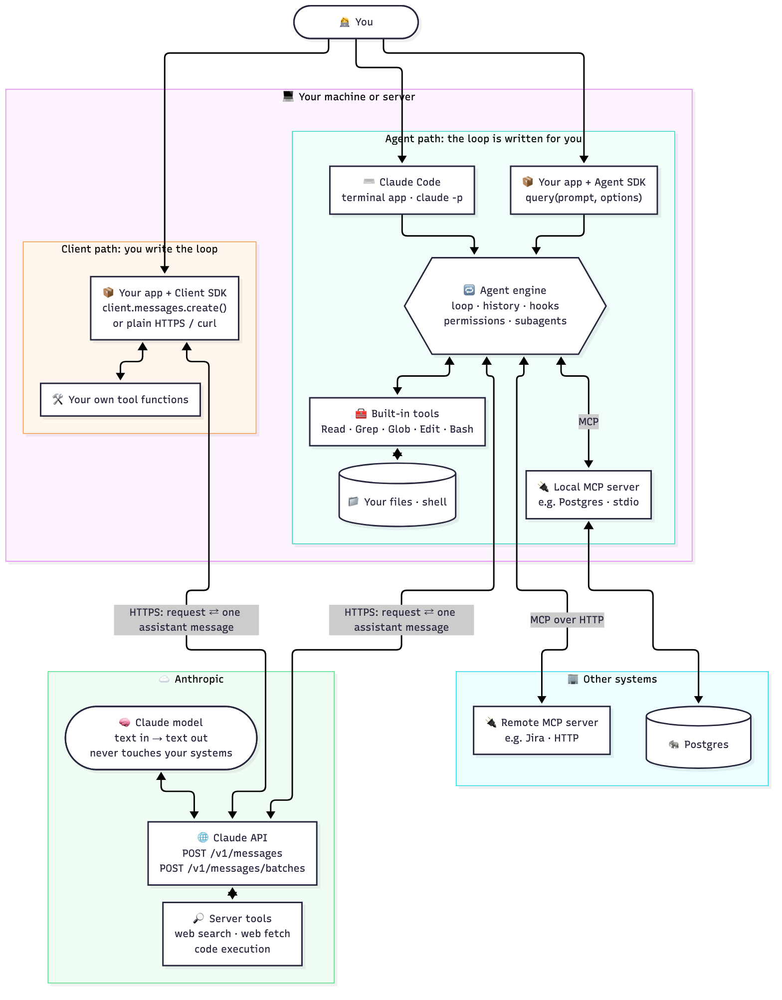
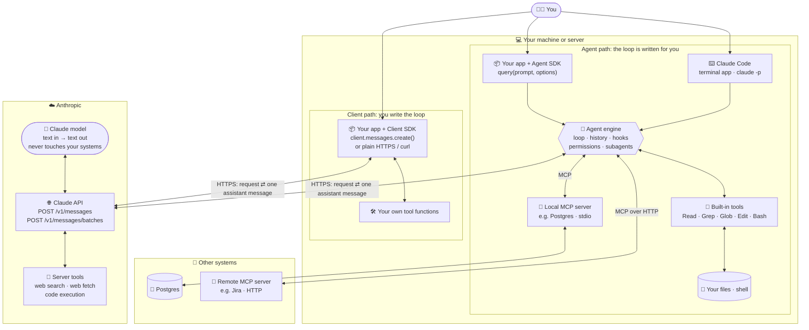
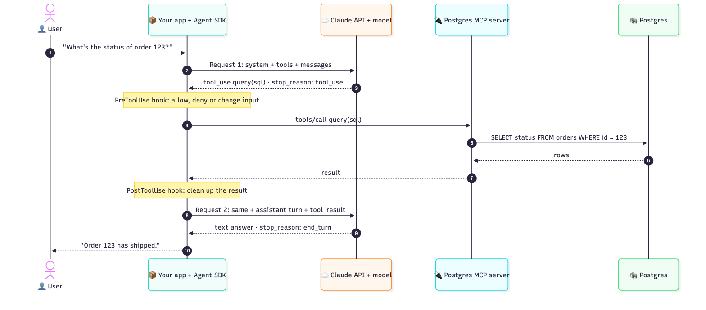
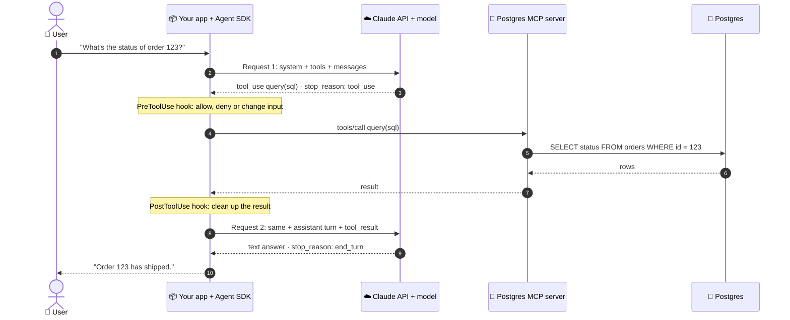

# Agentic Loop: The Message Cycle

> The agentic loop lifecycle: sending requests to Claude, inspecting stop_reason ("tool_use" vs "end_turn"), executing requested tools, and returning results for the next iteration ([[Domain-1-Agentic-Architecture#1.1 Design and implement agentic loops for autonomous task execution|Task 1.1]])

## Key ideas
---

- **The API is stateless.** It remembers nothing between calls. The history is a list kept by **your code**, and every request sends all of it again.

| Direction | Contains |
|---|---|
| **Request** (your code → API) | `system` + `tools` + the **full** message history |
| **Response** (API → your code) | **only** Claude's new turn, plus `stop_reason` |

- **`stop_reason` is set by Claude**, on the response only. It is never stored in the history; you copy only `role` and `content`.
  - `tool_use`: run the tools, then call the API again.
  - `end_turn`: done; show the text to the person.
  - `max_tokens`: the reply was cut off by the length limit.
    - `max_tokens` is **not a length hint**. Claude is not told to fit its answer inside it; it writes the reply as it normally would, and the API stops it at the cap, often mid-sentence. ^max-tokens-cutoff
    - Want a shorter answer? Ask for it in the prompt. Want the full answer? Raise `max_tokens`.
- **Roles:** `assistant` is Claude. `user` is everything sent back to Claude, including tool results that no person wrote.
- **`system` is a top-level field**, not a message.

<br>

## How the pieces connect
---

### Everything connected




- **Claude API** is the service on Anthropic's servers. Everything else ends up calling it.
- **Client SDK** is a library that sends those HTTPS calls for you; your code runs the loop and the tools.
- **Agent SDK** and **Claude Code** share one engine that runs the loop, the built-in tools, hooks and MCP connections for you.
- **MCP servers** are ordinary programs. Local ones run on your machine (stdio); remote ones run elsewhere (HTTP).
- **The model** only reads and writes text. Code (yours, the engine's, an MCP server's or Anthropic's) does every action.

### One tool call, end to end




<br>

## Example: fixing a bug in 4 cycles
---

Two files are shared in the first message. Claude makes 4 calls, one of them with two tools at once.

Every request below is shown as it is sent, with the whole history inside. How to read them:
- `// [n]` numbers each message in the history. `NEW` marks the messages added since the previous request.
- From request 2 on, `tools` is shortened to a comment only to save space here. The full definitions are sent every time.

### Cycle 1
**➡️ Request 1 (full)**
```json
{
  "model": "claude-opus-5-5",
  "max_tokens": 1024,
  "system": "You are a coding agent. Find and fix bugs. Run the tests before you finish.",
  "tools": [
    {
      "name": "bash",
      "description": "Run a shell command and return its output",
      "input_schema": { "type": "object", "properties": { "command": { "type": "string" } }, "required": ["command"] }
    },
    {
      "name": "grep",
      "description": "Search file contents with a regex",
      "input_schema": { "type": "object", "properties": { "pattern": { "type": "string" } }, "required": ["pattern"] }
    },
    {
      "name": "edit_file",
      "description": "Replace old_text with new_text in a file",
      "input_schema": {
        "type": "object",
        "properties": { "path": { "type": "string" }, "old_text": { "type": "string" }, "new_text": { "type": "string" } },
        "required": ["path", "old_text", "new_text"]
      }
    }
  ],
  "messages": [
    // [1] user · the question and two files · NEW
    {
      "role": "user",
      "content": [
        { "type": "text", "text": "<file path=\"src/refund.ts\">\nimport { applyTax } from \"./tax\";\nexport function refundTotal(items) {\n  const subtotal = items.reduce((sum, item) => sum + item.price, 0);\n  return applyTax(subtotal);\n}\n</file>" },
        { "type": "text", "text": "<file path=\"src/tax.ts\">\nexport function applyTax(amount) {\n  return amount * 1.25;\n}\n</file>" },
        { "type": "text", "text": "Refunding 2 × $50 gives $62.50 instead of $125. Why?" }
      ]
    }
  ]
}
```

**⬅️ Response 1**
```json
{
  "id": "msg_01",
  "type": "message",
  "role": "assistant",
  "content": [
    { "type": "text", "text": "refundTotal adds item.price but never multiplies by quantity. Let me confirm with the tests." },
    { "type": "tool_use", "id": "toolu_01", "name": "bash", "input": { "command": "npm test -- refund" } }
  ],
  "stop_reason": "tool_use"
}
```
`tool_use`, so your code runs the tests.

### Cycle 2
**➡️ Request 2 (full)**
Everything in request 1 is sent again, plus two messages at the end: response 1 as an `assistant` message (only `role` and `content` are copied; `id`, `type` and `stop_reason` are dropped), and the tool result as a new `user` message.
```json
{
  "model": "claude-opus-5-5",
  "max_tokens": 1024,
  "system": "You are a coding agent. Find and fix bugs. Run the tests before you finish.",
  "tools": [ /* bash, grep, edit_file: the same full definitions as request 1 */ ],
  "messages": [
    // [1] user · the question and two files (from request 1)
    {
      "role": "user",
      "content": [
        { "type": "text", "text": "<file path=\"src/refund.ts\">\nimport { applyTax } from \"./tax\";\nexport function refundTotal(items) {\n  const subtotal = items.reduce((sum, item) => sum + item.price, 0);\n  return applyTax(subtotal);\n}\n</file>" },
        { "type": "text", "text": "<file path=\"src/tax.ts\">\nexport function applyTax(amount) {\n  return amount * 1.25;\n}\n</file>" },
        { "type": "text", "text": "Refunding 2 × $50 gives $62.50 instead of $125. Why?" }
      ]
    },
    // [2] assistant · response 1 · NEW
    {
      "role": "assistant",
      "content": [
        { "type": "text", "text": "refundTotal adds item.price but never multiplies by quantity. Let me confirm with the tests." },
        { "type": "tool_use", "id": "toolu_01", "name": "bash", "input": { "command": "npm test -- refund" } }
      ]
    },
    // [3] user · result of toolu_01 · NEW
    {
      "role": "user",
      "content": [
        { "type": "tool_result", "tool_use_id": "toolu_01", "content": "FAIL refund.test.ts\n  expected 125, received 62.5" }
      ]
    }
  ]
}
```

**⬅️ Response 2:** two tool calls at once
```json
{
  "role": "assistant",
  "content": [
    { "type": "text", "text": "Confirmed. I'll fix it and check whether other files make the same mistake." },
    { "type": "tool_use", "id": "toolu_02", "name": "edit_file", "input": { "path": "src/refund.ts", "old_text": "sum + item.price", "new_text": "sum + item.price * item.quantity" } },
    { "type": "tool_use", "id": "toolu_03", "name": "grep", "input": { "pattern": "\\.price\\b" } }
  ],
  "stop_reason": "tool_use"
}
```

### Cycle 3
**➡️ Request 3 (full)**
Everything in request 2 is sent again, plus response 2 as an `assistant` message and both tool results in **one** new `user` message.
```json
{
  "model": "claude-opus-5-5",
  "max_tokens": 1024,
  "system": "You are a coding agent. Find and fix bugs. Run the tests before you finish.",
  "tools": [ /* bash, grep, edit_file: the same full definitions as request 1 */ ],
  "messages": [
    // [1] user · the question and two files (from request 1)
    {
      "role": "user",
      "content": [
        { "type": "text", "text": "<file path=\"src/refund.ts\">\nimport { applyTax } from \"./tax\";\nexport function refundTotal(items) {\n  const subtotal = items.reduce((sum, item) => sum + item.price, 0);\n  return applyTax(subtotal);\n}\n</file>" },
        { "type": "text", "text": "<file path=\"src/tax.ts\">\nexport function applyTax(amount) {\n  return amount * 1.25;\n}\n</file>" },
        { "type": "text", "text": "Refunding 2 × $50 gives $62.50 instead of $125. Why?" }
      ]
    },
    // [2] assistant · response 1 (from request 2)
    {
      "role": "assistant",
      "content": [
        { "type": "text", "text": "refundTotal adds item.price but never multiplies by quantity. Let me confirm with the tests." },
        { "type": "tool_use", "id": "toolu_01", "name": "bash", "input": { "command": "npm test -- refund" } }
      ]
    },
    // [3] user · result of toolu_01 (from request 2)
    {
      "role": "user",
      "content": [
        { "type": "tool_result", "tool_use_id": "toolu_01", "content": "FAIL refund.test.ts\n  expected 125, received 62.5" }
      ]
    },
    // [4] assistant · response 2 · NEW
    {
      "role": "assistant",
      "content": [
        { "type": "text", "text": "Confirmed. I'll fix it and check whether other files make the same mistake." },
        { "type": "tool_use", "id": "toolu_02", "name": "edit_file", "input": { "path": "src/refund.ts", "old_text": "sum + item.price", "new_text": "sum + item.price * item.quantity" } },
        { "type": "tool_use", "id": "toolu_03", "name": "grep", "input": { "pattern": "\\.price\\b" } }
      ]
    },
    // [5] user · results of toolu_02 and toolu_03, together · NEW
    {
      "role": "user",
      "content": [
        { "type": "tool_result", "tool_use_id": "toolu_02", "content": "Edited src/refund.ts" },
        { "type": "tool_result", "tool_use_id": "toolu_03", "content": "src/refund.ts:3: sum + item.price * item.quantity\nsrc/invoice.ts:7: total + line.price * line.quantity" }
      ]
    }
  ]
}
```

**⬅️ Response 3:** a tool call with no text
```json
{
  "role": "assistant",
  "content": [
    { "type": "tool_use", "id": "toolu_04", "name": "bash", "input": { "command": "npm test -- refund" } }
  ],
  "stop_reason": "tool_use"
}
```

### Cycle 4
**➡️ Request 4 (full)**
Everything in request 3 is sent again, plus response 3 as an `assistant` message and its tool result as a new `user` message. This is the whole conversation so far: 7 messages.
```json
{
  "model": "claude-opus-5-5",
  "max_tokens": 1024,
  "system": "You are a coding agent. Find and fix bugs. Run the tests before you finish.",
  "tools": [ /* bash, grep, edit_file: the same full definitions as request 1 */ ],
  "messages": [
    // [1] user · the question and two files (from request 1)
    {
      "role": "user",
      "content": [
        { "type": "text", "text": "<file path=\"src/refund.ts\">\nimport { applyTax } from \"./tax\";\nexport function refundTotal(items) {\n  const subtotal = items.reduce((sum, item) => sum + item.price, 0);\n  return applyTax(subtotal);\n}\n</file>" },
        { "type": "text", "text": "<file path=\"src/tax.ts\">\nexport function applyTax(amount) {\n  return amount * 1.25;\n}\n</file>" },
        { "type": "text", "text": "Refunding 2 × $50 gives $62.50 instead of $125. Why?" }
      ]
    },
    // [2] assistant · response 1 (from request 2)
    {
      "role": "assistant",
      "content": [
        { "type": "text", "text": "refundTotal adds item.price but never multiplies by quantity. Let me confirm with the tests." },
        { "type": "tool_use", "id": "toolu_01", "name": "bash", "input": { "command": "npm test -- refund" } }
      ]
    },
    // [3] user · result of toolu_01 (from request 2)
    {
      "role": "user",
      "content": [
        { "type": "tool_result", "tool_use_id": "toolu_01", "content": "FAIL refund.test.ts\n  expected 125, received 62.5" }
      ]
    },
    // [4] assistant · response 2 (from request 3)
    {
      "role": "assistant",
      "content": [
        { "type": "text", "text": "Confirmed. I'll fix it and check whether other files make the same mistake." },
        { "type": "tool_use", "id": "toolu_02", "name": "edit_file", "input": { "path": "src/refund.ts", "old_text": "sum + item.price", "new_text": "sum + item.price * item.quantity" } },
        { "type": "tool_use", "id": "toolu_03", "name": "grep", "input": { "pattern": "\\.price\\b" } }
      ]
    },
    // [5] user · results of toolu_02 and toolu_03, together (from request 3)
    {
      "role": "user",
      "content": [
        { "type": "tool_result", "tool_use_id": "toolu_02", "content": "Edited src/refund.ts" },
        { "type": "tool_result", "tool_use_id": "toolu_03", "content": "src/refund.ts:3: sum + item.price * item.quantity\nsrc/invoice.ts:7: total + line.price * line.quantity" }
      ]
    },
    // [6] assistant · response 3 · NEW
    {
      "role": "assistant",
      "content": [
        { "type": "tool_use", "id": "toolu_04", "name": "bash", "input": { "command": "npm test -- refund" } }
      ]
    },
    // [7] user · result of toolu_04 · NEW
    {
      "role": "user",
      "content": [
        { "type": "tool_result", "tool_use_id": "toolu_04", "content": "PASS refund.test.ts (3 tests)" }
      ]
    }
  ]
}
```

**⬅️ Response 4:** the final answer
```json
{
  "role": "assistant",
  "content": [
    { "type": "text", "text": "Fixed. refundTotal ignored quantity, so 2 × $50 counted as $50. It now multiplies price by quantity, and the tests pass. invoice.ts already does this correctly." }
  ],
  "stop_reason": "end_turn"
}
```
`end_turn`, so the loop stops. This text is what the person sees.

Request 4 sent all 7 messages, but response 4 holds only this one new message. If the conversation went on, your code would add it to the list as message `[8]`.

<br>

## Rules
---

- Roles always alternate: user, assistant, user, assistant.
- Every `tool_use` gets a `tool_result` with the same id in the **very next** user message. If Claude calls several tools at once, all the results go in that one message.
- A response can be text + tool calls, tool calls only, or text only.
- If a tool fails, add `"is_error": true` to its `tool_result`, so Claude knows and can react.

<br>

## Exam links
---

- **The request keeps growing.** Every tool result is sent again on every later call. So trim long tool output to the fields you need, and keep a "case facts" block so key details survive summarizing ([[Domain-5-Context-Management#5.1 Manage conversation context to preserve critical information across long interactions|Task 5.1]]).
- **Claude knows only what's in the list.** A subagent is just a new, empty list, which is why it doesn't inherit the coordinator's history (Tasks [[Domain-1-Agentic-Architecture#1.2 Orchestrate multi-agent systems with coordinator-subagent patterns|1.2]], [[Domain-1-Agentic-Architecture#1.3 Configure subagent invocation, context passing, and spawning|1.3]]).
- **The Agent SDK and Claude Code keep this list for you.** You see the same pairs as `AssistantMessage` and `UserMessage`, and `/compact` shrinks the list when it gets long ([[Domain-5-Context-Management#5.4 Manage context effectively in large codebase exploration|Task 5.4]]).
- **Stop on `stop_reason`**, never on the text or a turn count ([[Domain-1-Agentic-Architecture#1.1 Design and implement agentic loops for autonomous task execution|Task 1.1]]; see [[Agentic-Loop-Anti-Patterns|Agentic Loop Anti-Patterns]]).

<br>

## Related
---

- [[Agentic-Loop-Anti-Patterns|Agentic Loop Anti-Patterns]]
- [[User-vs-Assistant-Messages|User vs Assistant Messages in Tool Calls]]
- [[Agent-SDK-vs-Client-SDK|Agent SDK vs Client SDK]]
- [[Claude-API-Anthropic-Client-SDK|Claude API: Anthropic Client SDK]]
- [[Tool-Choice|Tool Choice]]
- [[Claude-Technologies-Reference#Claude API Messages API|Messages API fields (reference)]]
