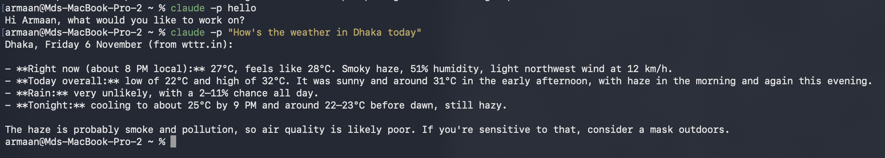

# Claude Code Headless Mode

`claude -p` runs Claude Code without the interactive screen: it runs the prompt, prints the result and exits. This is how a CI pipeline uses it ([[Scenario-5-Claude-Code-in-CI|Scenario 5]]).

## Related
- [[Claude-Technologies-Reference#Claude Code CLI|Claude Code CLI flags (reference)]]
