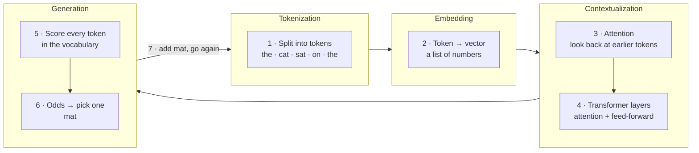
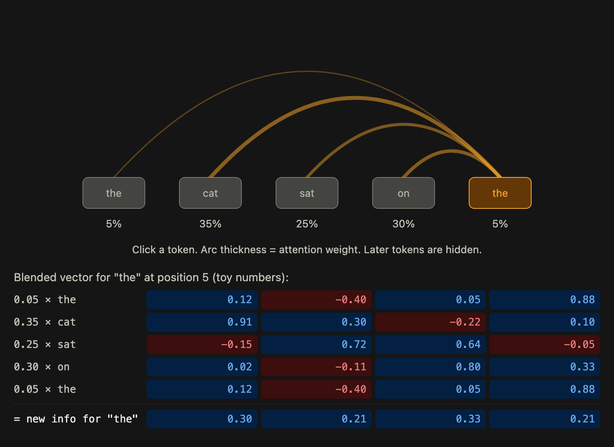
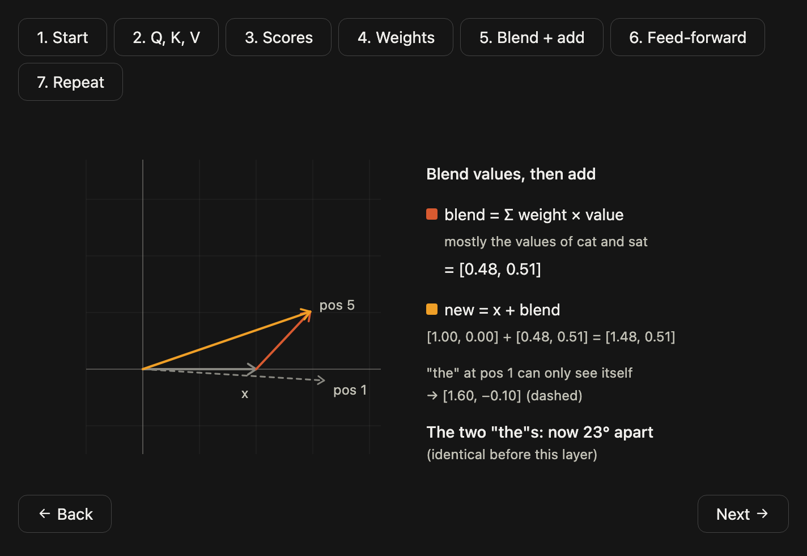

# Inference: How Claude Predicts the Next Token (background)

Claude writes one token at a time: score every possible next token, pick one, add it, repeat. The exam leaves model internals out, but tests [[#Why it matters|what follows from them]].

Toy prompt throughout: **"the cat sat on the" → "mat"**, with made-up numbers.

 

## At a glance
---

| Step | What happens | Toy example |
|---|---|---|
| 1 · Tokens | The text is split into **tokens** from a fixed **vocabulary** | `the` · `cat` · `sat` · `on` · `the` |
| 2 · Vectors | Each token becomes a list of numbers, its **embedding** | `cat` → `[0.91, 0.30, −0.22, 0.10]` |
| 3 · Attention | Each token blends in the tokens before it | last `the`: 35% `cat`, 30% `on`, 25% `sat` |
| 4 · Layers | Attention + feed-forward, many layers deep | the two `the`s, identical in step 2, are now 23° apart |
| 5 · Scores | The last token's vector scores every token in the vocabulary | `mat` high, `banana` very low |
| 6 · Pick | **Softmax** turns the scores into odds, and one token is drawn | `mat` 60% · `floor` 25% · … |
| 7 · Repeat | Add the token and go again, until a [[Claude-API-Tool-Use#Stop reason\|stop reason]] | "…on the mat" → "." |

 

## The diagrams
---

Snapshots: each link opens the interactive version in your browser.

### Vectors: direction is meaning
Similar meanings point the same way. **Cosine similarity** measures it: 1 same, 0 unrelated, −1 opposite.

[Open the interactive version](../assets/Inference-Cosine-Similarity.html): rotate b with the slider.

### Attention: look back, blend in
The weights add up to 100%. Later tokens are hidden, so the model can't peek at the answer.

[Open the interactive version](../assets/Inference-Attention-Weights.html): click a token.

### One transformer layer
**Query** (what I look for) · **key** (what I offer) → **softmax** weights → blend of **values**, added to the token → feed-forward → next layer. **Parameters** are all these learned numbers: set in training, fixed during inference.

[Open the interactive version](../assets/Inference-Transformer-Layer.html): step through with Back and Next.

### Picking the next token

| Next token | Odds |
|---|---|
| `mat` | ████████████ 60% |
| `floor` | █████ 25% |
| `couch` | ██ 10% |
| everything else | █ 5% |

Low **temperature** sharpens the odds toward `mat`; high evens them out ([[Claude-API-Accessing-Claude#Temperature|Temperature]]). The draw is random, so the same prompt can give different replies.

 

## Why it matters
---

- **It only sees what you send.** No memory between calls, so each request carries the whole history ([[Agentic-Loop-Message-Cycle|message cycle]]).
- **One token at a time.** Replies can stream, and `max_tokens` cuts a reply off instead of shortening it ([[Agentic-Loop-Message-Cycle#^max-tokens-cutoff|why]]).
- **Every token is a random draw.** Temperature shifts the odds but guarantees nothing. A strict schema guarantees the shape; your code still checks the values ([[JSON-Schema-for-Structured-Extraction|JSON Schema]]).
- **A tool call is generated text.** Claude writes the call and stops; your code runs the tool.
- **Attention is shared.** The weights add up to 100%, so the longer the input, the thinner each part's share. ^attention-dilution
- **Earlier work is reused.** Prompt caching skips a prefix that was already processed ([[Claude-Technologies-Reference#Prompt caching|prompt caching]]).

> [!tip] Exam tip
> A bigger context window doesn't fix attention dilution. Split the work into focused passes, one per file plus an integration pass ([[Domain-4-Prompt-Engineering#4.6 Design multi-instance and multi-pass review architectures|Task 4.6]]), and put key findings first, since the middle of a long input is easy to miss ([[Domain-5-Context-Management#5.1 Manage conversation context to preserve critical information across long interactions|Task 5.1]]).

^exam-tip

 

## Related
---

- [[Claude-API-Accessing-Claude#Accessing the API|Accessing the API]]: the course slides for the four stages
- [[Claude-API-RAG#Find the closest chunks|RAG and Agentic Search]]: the same cosine similarity, used to find relevant chunks
- [[Agentic-Loop-Message-Cycle|Agentic Loop: The Message Cycle]]
