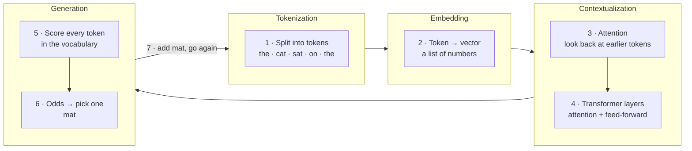
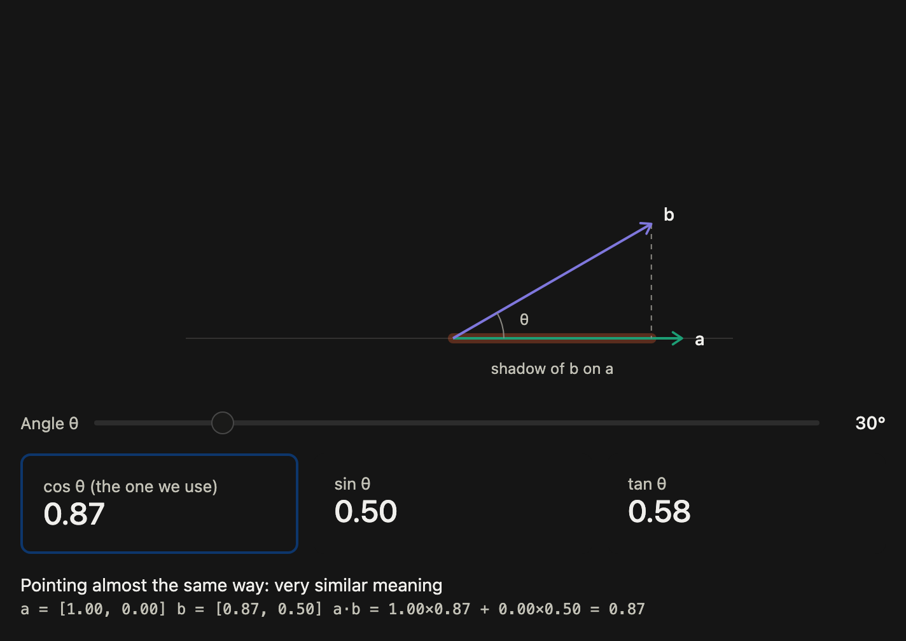

# Inference: How Claude Predicts the Next Token (background)

**Inference** is running a trained model to get output. Claude writes a reply one token at a time: it reads all the text so far, gives every possible next token a probability, picks one, adds it to the text, and goes again.

This note follows one prediction for the toy prompt "the cat sat on the", whose likely next token is "mat". Three interactive diagrams show the key steps with small, made-up numbers. Each picture is a snapshot: the link under it opens the diagram in your browser, because Obsidian can't run HTML inside a note.

The exam guide lists Claude's internal architecture as out of scope, so this is background. What the exam does test follows from it: see [[#What this means in practice|what this means in practice]] and [[#Exam links|exam links]].

 

## At a glance
---

The four stages are the ones on the course slides in [[Claude-API-Anthropic-Client-SDK#Accessing the API|Accessing the API]].

 

## Tokenization
---

### 1. Split into tokens
- The model doesn't read letters or words. It reads **tokens**: common words, pieces of longer words, punctuation and spaces.
- Each token is an ID from a fixed list, the model's **vocabulary**.
- Toy example: "the cat sat on the" → `the` · `cat` · `sat` · `on` · `the`.
- `max_tokens`, the context window and the `usage` counts are all measured in tokens.

 

## Embedding
---

### 2. Token → vector
- Each token is swapped for a **vector**: a list of numbers, looked up in a table the model learned in training. This starting vector is the token's **embedding**.
- Real vectors have thousands of numbers. The diagrams use 2 to 4, so they can be drawn.
- **Direction carries meaning.** Tokens with similar meanings get vectors that point in similar directions.
- **Cosine similarity** measures this: 1 = same direction, 0 = unrelated, −1 = opposite. It's the dot product of the two vectors, divided by their lengths multiplied together.
- Both `the`s get the same vector: no context yet. (Real models also mark each token's position, so word order counts. The toy leaves that out.)

[Open the interactive version](../assets/Inference-Cosine-Similarity.html): drag the slider to rotate b and watch its shadow on a, the cosine, shrink. The dot product it prints is the same sum attention uses to score tokens in step 4.

 

## Contextualization
---

### 3. Attention
- **Attention** lets each token take in information from the tokens before it.
- A token gives each earlier token, and itself, a **weight**. The weights add up to 100%.
- It then takes a **blend**: each of those tokens' vectors times its weight, all added up. The blend is what the token takes in.
- A token can only look back, never ahead: when the model predicts what follows "the", it can't see the answer.
- In the toy, the last `the` takes mostly from `cat` (35%), `on` (30%) and `sat` (25%): the next word names what the cat sat on.

[Open the interactive version](../assets/Inference-Attention-Weights.html): click a token to see where it looks.

### 4. Transformer layers
A **transformer layer** is attention plus a feed-forward step, and the model runs many layers in a row. The diagram walks through one layer with 2-number vectors:

| Step | What happens |
|---|---|
| Q, K, V | Three learned matrices turn each token's vector into a **query** (what I'm looking for), a **key** (what I offer) and a **value** (what I hand over if picked) |
| Scores | Query · key, for every token it can see. Keys that point the same way as the query score high: the dot product again, without dividing by lengths |
| Weights | **Softmax** turns the scores into weights that add up to 1 |
| Blend + add | The weighted values are added to the token's own vector. The two `the`s, identical before, now point 23° apart: the second has taken in its context |
| Feed-forward | Each token on its own: spread into more numbers, switch off the negatives, shrink back, add |
| Repeat | The next layer starts from these new vectors, with its own matrices |

- **Parameters** (also called weights) are the numbers in all these tables and matrices. Training sets them; inference only uses them. "Billions of parameters" means billions of these numbers.
- A real model is the same idea, bigger: thousands of numbers per vector, many attention heads per layer, and dozens of layers.

[Open the interactive version](../assets/Inference-Transformer-Layer.html): step through the layer with Back and Next.

 

## Generation
---

### 5. Score every token in the vocabulary
- Only the **last** token's final vector is used to predict what comes next.
- The **output layer** compares it with every token in the vocabulary and gives each one a score: `mat` high, `floor` a bit lower, `banana` very low.

### 6. Pick one
- **Temperature** adjusts the scores: low makes the likeliest tokens even likelier, high evens the odds out. It's the `temperature` request field, on models that accept it ([[Claude-API-Anthropic-Client-SDK#Temperature|Temperature]]).
- **Softmax** turns the scores into probabilities that add up to 100%.
- One token is **picked at random by those odds**. The likeliest usually wins, but not always, so the same prompt can give different replies.

### 7. Add it and repeat
- The picked token is added to the text, and the model predicts the next one: "the cat sat on the mat", then ".", and so on.
- Earlier tokens aren't worked out again: their keys and values from step 4 are kept, so each new token takes one pass through the layers.
- The loop stops when one of these happens, and the response's `stop_reason` says which:

| What happened | `stop_reason` |
|---|---|
| Claude picked its end-of-sequence token: the reply is done | `end_turn` |
| The reply reached `max_tokens` | `max_tokens` |
| Claude wrote one of your `stop_sequences` | `stop_sequence` |
| Claude wrote a tool call: your code runs the tool and sends back the result | `tool_use` |

 

## What this means in practice
---

- **Claude sees only the tokens you send.** It keeps no memory between calls, so each request carries the whole history ([[Agentic-Loop-Message-Cycle|Agentic Loop: The Message Cycle]]).
- **It writes one token at a time.** So a reply can be streamed while it's written ([[Claude-API-Anthropic-Client-SDK#Response Streaming|Response Streaming]]), and `max_tokens` cuts a reply off instead of making it shorter ([[Agentic-Loop-Message-Cycle#^max-tokens-cutoff|why]]).
- **Each token is a weighted random pick.** The same prompt can give different replies, and temperature only changes the odds. A strict JSON schema guarantees the shape, because the API only lets Claude pick tokens that keep the output valid; your validation code still checks the values ([[JSON-Schema-for-Structured-Extraction|JSON Schema for Structured Extraction]]).
- **A tool call is generated text too.** Claude writes the tool's name and input as tokens, then stops; your code runs the tool ([[Claude-API-Anthropic-Client-SDK#Tool Use with Claude|Tool Use with Claude]]).
- **Attention is shared across the whole context.** Each token's weights add up to 100%, so in a long input many tokens compete for them. That's a useful picture of why one pass over a lot of material gives uneven depth ([[#Exam links|exam links]]). ^attention-dilution
- **Work on earlier tokens is reused.** Prompt caching does the same across requests: a prefix that was already processed isn't processed again ([[Claude-Technologies-Reference#Prompt caching|Prompt caching]]).

 

## Exam links
---

- **Lost in the middle.** Models handle the start and end of long inputs well but may miss findings in the middle. Put a summary of the key findings first, and give detailed results clear section headers ([[Domain-5-Context-Management#5.1 Manage conversation context to preserve critical information across long interactions|Task 5.1]]).
- **Attention dilution.** One review pass over 14 files gives deep feedback on some files and shallow feedback on others. The fix is a focused pass per file plus a separate integration pass for cross-file issues ([[Domain-4-Prompt-Engineering#4.6 Design multi-instance and multi-pass review architectures|Task 4.6]]).

> [!tip] Exam tip
> A bigger context window doesn't fix attention dilution. When one pass over a long input misses things or gives uneven results, pick the answer that splits the work into focused passes, puts key findings first, or trims what isn't needed, not the one that moves to a model with a larger context window.

^exam-tip

 

## Terms
---

| Term | Meaning |
|---|---|
| Inference | Running a trained model to get output |
| Token | A piece of text the model reads or writes: a word, part of a word, or punctuation |
| Vocabulary | Every token the model knows. Step 5 scores all of them |
| Vector | A list of numbers. With 2 numbers it can be drawn as an arrow |
| Embedding | The vector a token starts with, looked up in a learned table |
| Cosine similarity | How closely two vectors point the same way: 1 same, 0 unrelated, −1 opposite |
| Attention | Each token taking in a weighted blend of the tokens before it |
| Query, key, value | What a token looks for, what it offers, and what it hands over if picked |
| Softmax | Turns scores into weights or probabilities that add up to 1 |
| Parameters | The learned numbers in every table and matrix. Set in training, fixed during inference |
| Temperature | Reshapes the odds before the pick: low sharpens them, high evens them out |
| Context window | The most tokens one request can hold, counting the reply |

 

## Related
---

- [[Claude-API-Anthropic-Client-SDK#Accessing the API|Accessing the API (Client SDK note)]]: the course slides for these four stages
- [[Claude-API-Anthropic-Client-SDK#Temperature|Temperature (Client SDK note)]]
- [[Agentic-Loop-Message-Cycle|Agentic Loop: The Message Cycle]]
- [[Claude-Technologies-Reference#Response fields|stop_reason and usage (reference)]]
- [[Courses-by-Anthropic|Courses by Anthropic]]: course 2, Building with the Claude API
