# Claude API: Anthropic Client SDK

Calling the Claude API from Python with the `anthropic` package, the Client SDK. For how it differs from the Agent SDK, see [[Agent-SDK-vs-Client-SDK|Agent SDK vs Client SDK]].

<br>

## Accessing the API
---

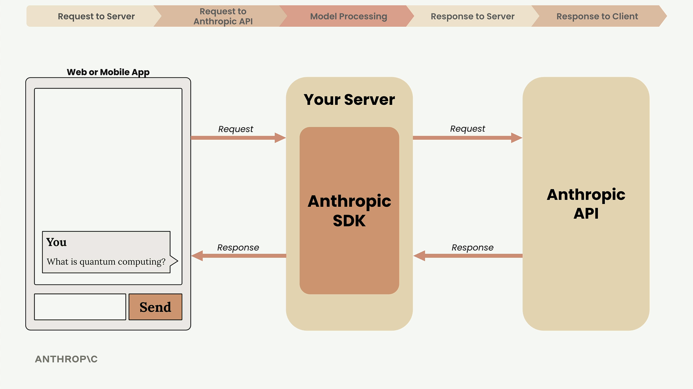

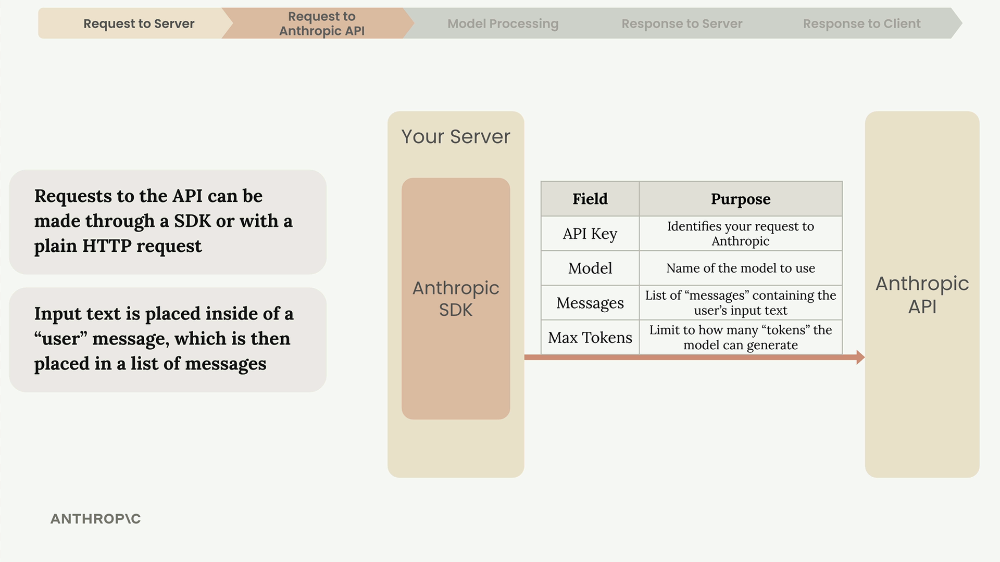

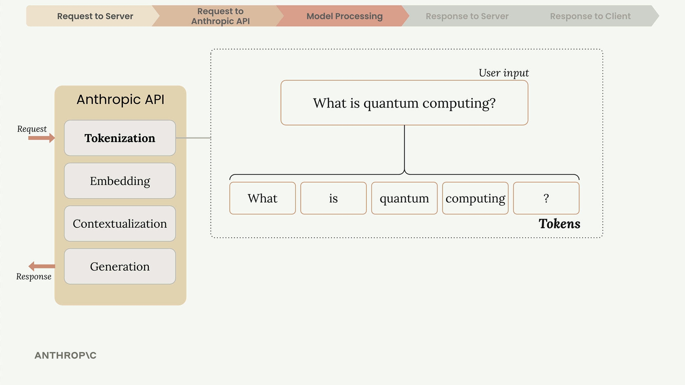

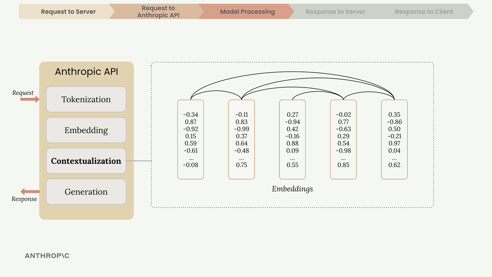

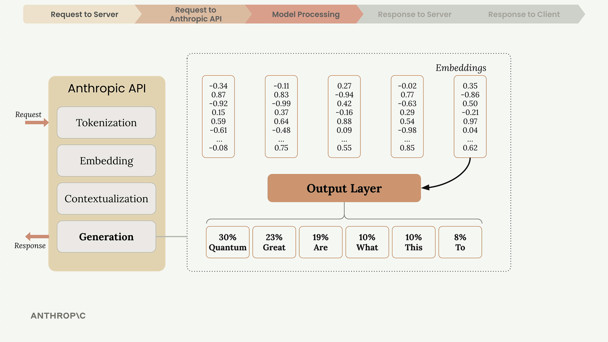

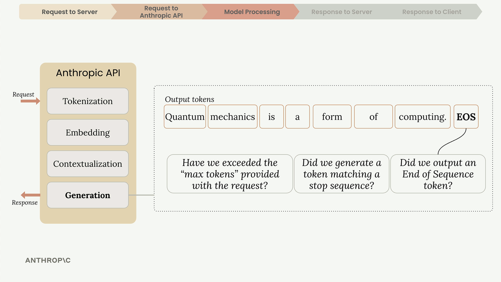

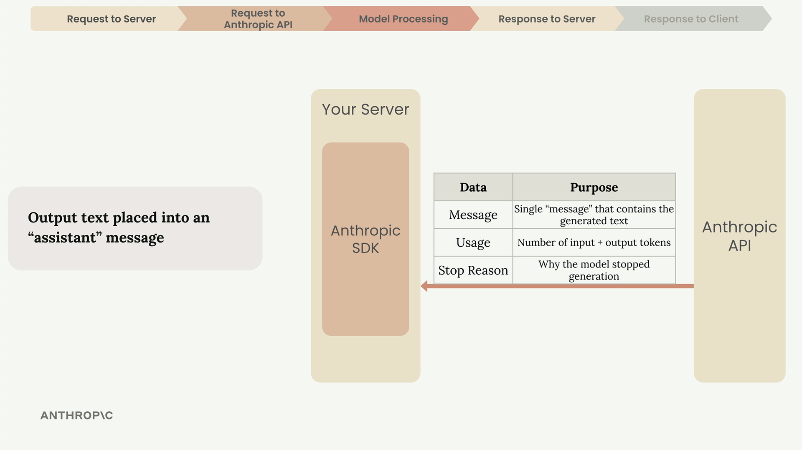

<br>

## Setup
---

Install the SDK and `python-dotenv` (in a notebook cell):

```python
%pip install anthropic python-dotenv
```

Put your key in a `.env` file, and keep that file out of git:

```bash
ANTHROPIC_API_KEY="your-api-key-here"
```

Load it into the environment, where the SDK looks for the key:

```python
from dotenv import load_dotenv
load_dotenv()
```

Create the client, which reads that key, and choose a model:

```python
from anthropic import Anthropic

client = Anthropic()
model = "claude-opus-5-5"
```

<br>

## Making Your First Request
---

Here's a complete example of making a request to Claude:

```python
message = client.messages.create(
    model=model,
    max_tokens=1000,
    messages=[
        {
            "role": "user",
            "content": "What is quantum computing? Answer in one sentence"
        }
    ]
)
```

- `model`: which Claude model answers.
- `max_tokens`: a hard cap on the reply, not a length hint ([[Agentic-Loop-Message-Cycle#^max-tokens-cutoff|why]]).
- `messages`: the conversation so far, here a single `user` message ([[User-vs-Assistant-Messages|roles]]).
- Returns one assistant message: `content`, `stop_reason`, `usage` ([[Claude-Technologies-Reference#Response fields|response fields]]).

<br>

## Extracting the Response
---

`message.content` is a list of [[Claude-Technologies-Reference#Content blocks|content blocks]]. Two ways to get the text:

```python
message.content[0].text  # By order: breaks if a thinking block comes first
next(block.text for block in message.content if block.type == "text")  # By type
```

<br>

## Multi-Turn Conversations
---

The API keeps no memory between calls, so every call sends the whole history ([[Agentic-Loop-Message-Cycle|why]]). Helpers that build the list and send it:

```python
def add_user_message(messages, text):
    user_message = {"role": "user", "content": text}
    messages.append(user_message)

def add_assistant_message(messages, text):
    assistant_message = {"role": "assistant", "content": text}
    messages.append(assistant_message)

def chat(messages):
    message = client.messages.create(
        model=model,
        max_tokens=1000,
        messages=messages,
    )
    return message.content[0].text
```

A follow-up question that relies on the first answer:

```python
messages = []  # Start with an empty message list
add_user_message(messages, "Define quantum computing in one sentence")  # Add the initial user question
answer = chat(messages)  # Get Claude's response
add_assistant_message(messages, answer)  # Add Claude's response to the conversation history
add_user_message(messages, "Write another sentence")  # Add a follow-up question
final_answer = chat(messages)  # Get the follow-up response with full context
```

A basic chat loop on the same helpers (runs until you stop it):

```python
while True:
    user_input = input("> ")  # Get user input
    print(">", user_input)
    add_user_message(messages, user_input)  # Add user input to the list of messages
    answer = chat(messages)  # Call Claude with the 'chat' function
    add_assistant_message(messages, answer)  # Add generated text to the list of messages
    print(answer)  # Print the generated text
```

<br>

## System Prompts
---

`system` is a top-level field, not a message ([[Claude-Technologies-Reference#Request fields|request fields]]). The `chat` helper with a system prompt:

```python
def chat(messages):
    system = """
    You are a patient math tutor.
    Do not directly answer a student's questions.
    Guide them to a solution step by step.
    """
    message = client.messages.create(
        model=model,
        max_tokens=1000,
        messages=messages,
        system=system,
    )
    return message.content[0].text
```

<br>

## Temperature
---

`temperature` (0 to 1) changes how likely each next token is to be picked: low gives predictable output, high gives varied output.

Remember that temperature doesn't guarantee different outputs - it just changes the probability of getting them.

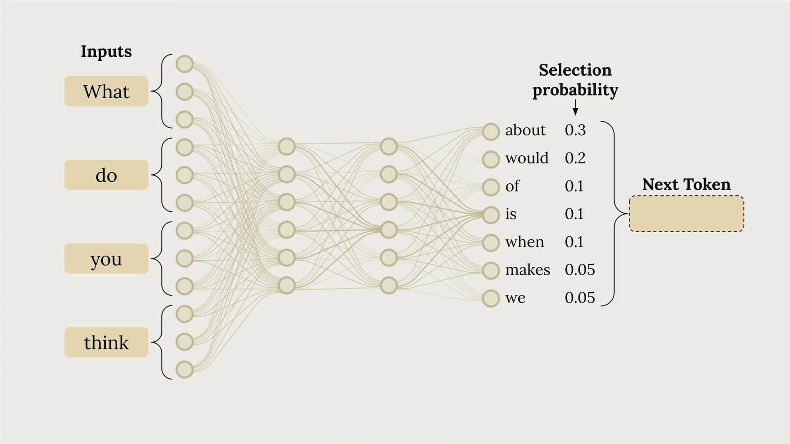

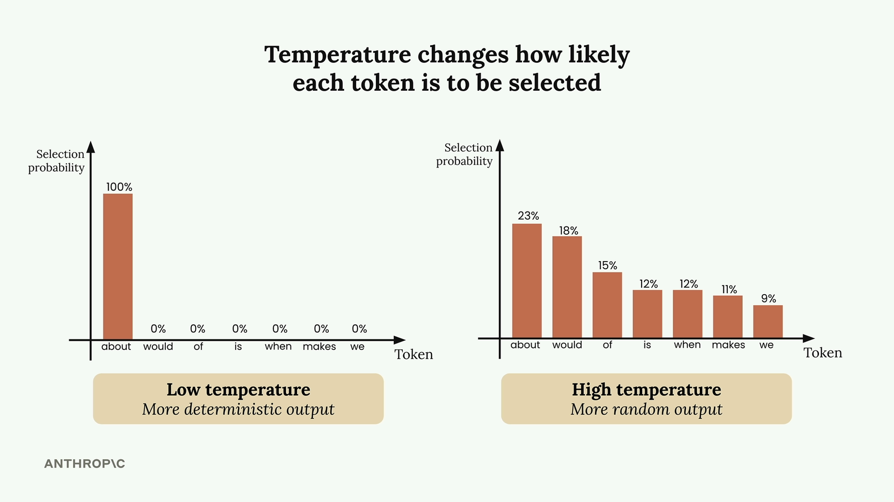

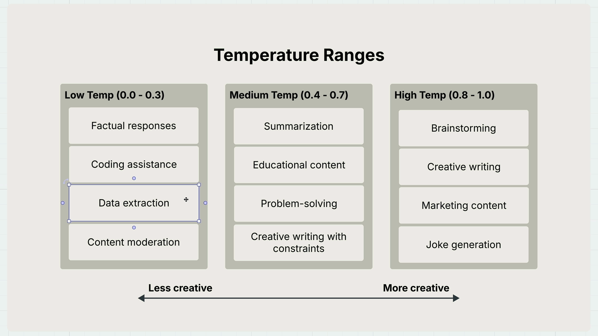

Set it as a request field:

```python
params = {
    "model": model,
    "max_tokens": 1000,
    "messages": messages,
    "temperature": temperature
}
```

Newer models, including `claude-opus-5-5` above, reject `temperature` with a 400 error. It still works on older models such as Claude Sonnet 4.6 with an older SDK.

<br>

## Response Streaming
---

Streaming sends the reply in pieces as it's generated, so the user sees text right away.

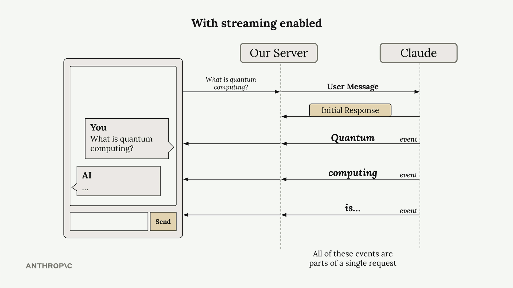

```python
with client.messages.stream(
    model=model,
    max_tokens=1000,
    messages=messages
) as stream:
    for text in stream.text_stream:
        print(text, end="")
        
    final_message = stream.get_final_message()  # Get the complete message for database storage
```

<br>

## Stop Sequences
---

`stop_sequences` ends the reply as soon as Claude writes one of the listed strings. The response then has `stop_reason: "stop_sequence"`.

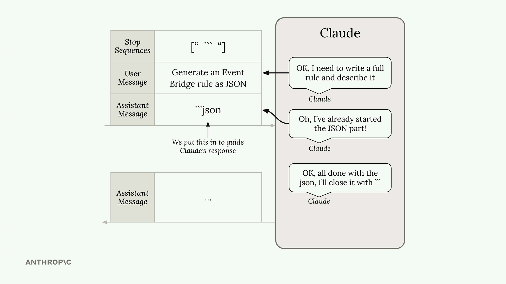

The slide also prefills the assistant message to start the JSON. Current models, including `claude-opus-5-5`, reject a prefill with a 400 error, so for JSON use tool use with a schema ([[JSON-Schema-for-Structured-Extraction|JSON Schema for Structured Extraction]]).

<br>

## Prompt Evaluation
---

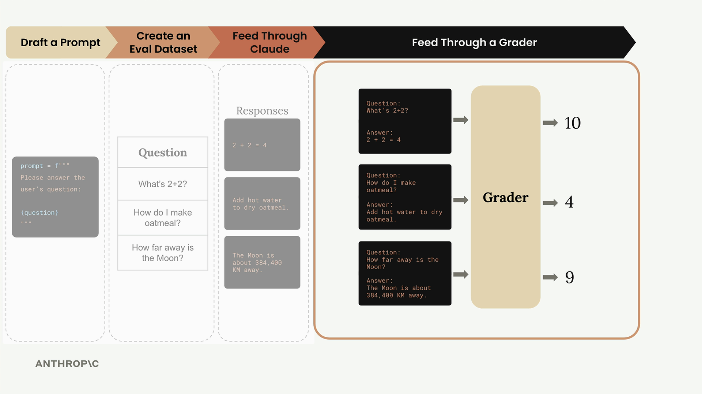

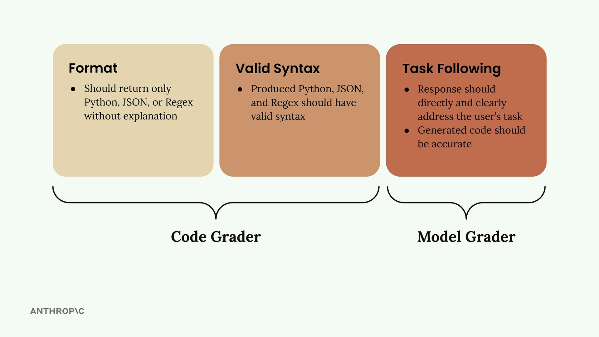

A model grader. It uses the prefill and stop sequence from [[#Stop Sequences|Stop Sequences]], so it needs an older model and a `chat` helper that takes `stop_sequences`.

````python
import json

def grade_by_model(test_case, output):
    # Create evaluation prompt
    eval_prompt = """
    You are an expert code reviewer. Evaluate this AI-generated solution.

    Task: {task}
    Solution: {solution}

    Provide your evaluation as a structured JSON object with:
    - "strengths": An array of 1-3 key strengths
    - "weaknesses": An array of 1-3 key areas for improvement
    - "reasoning": A concise explanation of your assessment
    - "score": A number between 1-10
    """.format(task=test_case["task"], solution=output)

    messages = []
    add_user_message(messages, eval_prompt)
    add_assistant_message(messages, "```json")

    eval_text = chat(messages, stop_sequences=["```"])
    return json.loads(eval_text)
````

<br>

## Prompt Engineering
---

Writing prompts that get the output you want on the first try. On the exam, this is [[Domain-4-Prompt-Engineering|Domain 4]] (20%).

### Be clear and direct
- Open with one plain sentence that states the task.
- Give an instruction, not a question, and start it with an action verb: "Write", "Create", "Identify".

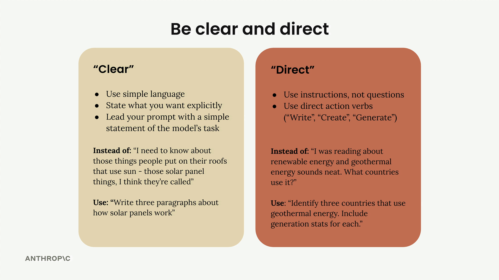

### Be specific
Add a list of guidelines under the task. They come in two kinds:
- **Qualities** the output should have, such as a length limit or what it must include.
- **Steps** Claude should follow to get there, such as brainstorming options and then picking one.

Explicit criteria like these are what [[Domain-4-Prompt-Engineering#4.1 Design prompts with explicit criteria to improve precision and reduce false positives|Task 4.1]] tests.

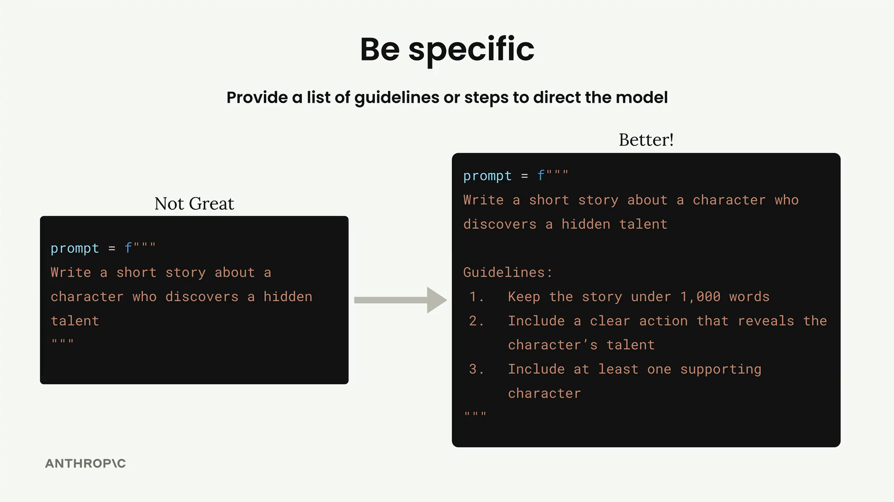

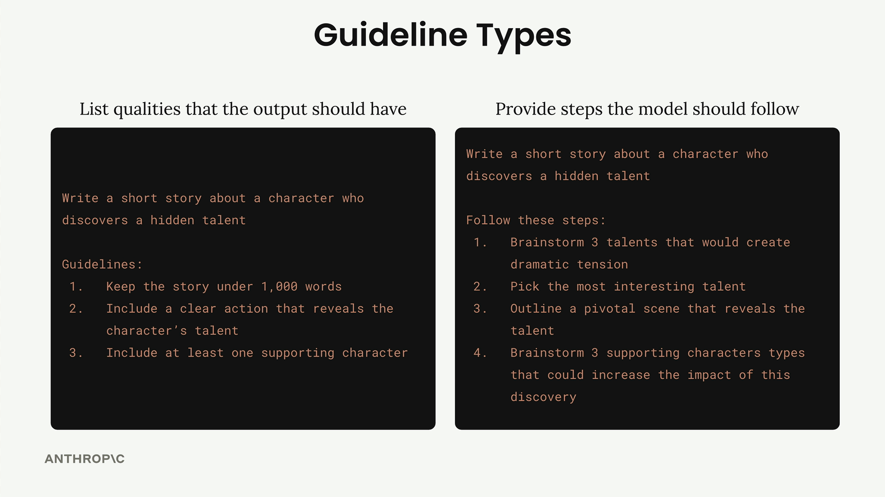

### Structure with XML tags
Wrap each piece of content in its own tag, such as `<my_code>` and `<docs>`. Claude can then tell your instruction apart from the material it works on, and one piece of material from another. The tag names are up to you: pick ones that describe the content.

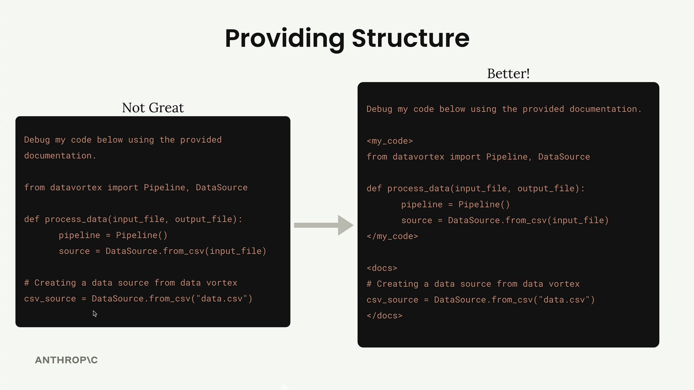

<br>

## Tool Use with Claude
---

Claude never runs your tools. It asks for one, your code runs it, and you send the result back ([[Agentic-Loop-Message-Cycle#One tool call, end to end|one tool call, end to end]]). The course splits this into five steps: write a tool function, write its JSON schema, call Claude with the schema, run the tool, then add the result and call Claude again.

### Tool functions
A plain Python function that your code runs when Claude asks for it. Give it descriptive argument names, validate its inputs, and raise clear errors: the error goes back to Claude, which can then try again.

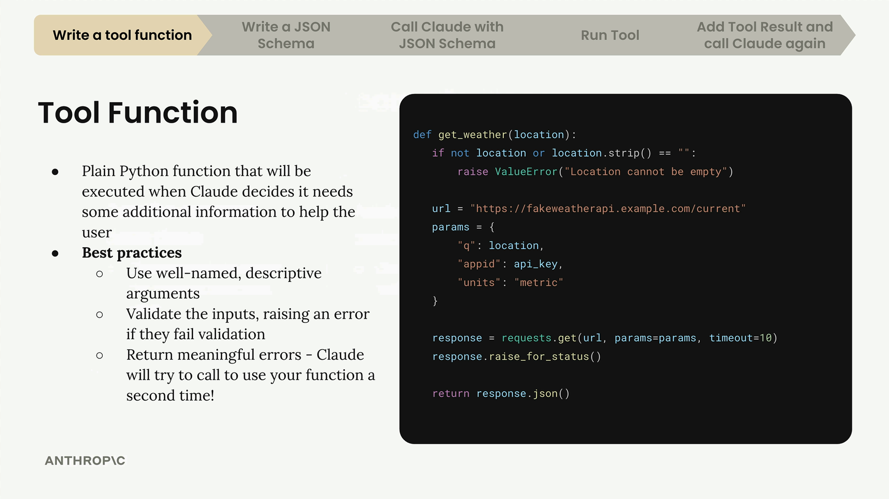

### Tool schemas
The schema is how Claude learns the tool exists. `name` and `description` tell it when to use the tool, and `input_schema` describes the arguments as a JSON Schema. Clear, detailed descriptions like the ones below are what [[Domain-2-Tool-Design-and-MCP#2.1 Design effective tool interfaces with clear descriptions and boundaries|Task 2.1]] tests.

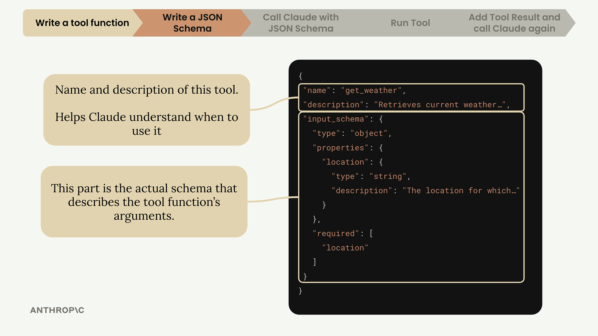

```python
add_duration_to_datetime_schema = {
    "name": "add_duration_to_datetime",
    "description": "Adds a specified duration to a datetime string and returns the resulting datetime in a detailed format. This tool converts an input datetime string to a Python datetime object, adds the specified duration in the requested unit, and returns a formatted string of the resulting datetime. It handles various time units including seconds, minutes, hours, days, weeks, months, and years, with special handling for month and year calculations to account for varying month lengths and leap years. The output is always returned in a detailed format that includes the day of the week, month name, day, year, and time with AM/PM indicator (e.g., 'Thursday, April 03, 2025 10:30:00 AM').",
    "input_schema": {
        "type": "object",
        "properties": {
            "datetime_str": {
                "type": "string",
                "description": "The input datetime string to which the duration will be added. This should be formatted according to the input_format parameter.",
            },
            "duration": {
                "type": "number",
                "description": "The amount of time to add to the datetime. Can be positive (for future dates) or negative (for past dates). Defaults to 0.",
            },
            "unit": {
                "type": "string",
                "description": "The unit of time for the duration. Must be one of: 'seconds', 'minutes', 'hours', 'days', 'weeks', 'months', or 'years'. Defaults to 'days'.",
            },
            "input_format": {
                "type": "string",
                "description": "The format string for parsing the input datetime_str, using Python's strptime format codes. For example, '%Y-%m-%d' for ISO format dates like '2025-04-03'. Defaults to '%Y-%m-%d'.",
            },
        },
        "required": ["datetime_str"],
    },
}

set_reminder_schema = {
    "name": "set_reminder",
    "description": "Creates a timed reminder that will notify the user at the specified time with the provided content. This tool schedules a notification to be delivered to the user at the exact timestamp provided. It should be used when a user wants to be reminded about something specific at a future point in time. The reminder system will store the content and timestamp, then trigger a notification through the user's preferred notification channels (mobile alerts, email, etc.) when the specified time arrives. Reminders are persisted even if the application is closed or the device is restarted. Users can rely on this function for important time-sensitive notifications such as meetings, tasks, medication schedules, or any other time-bound activities.",
    "input_schema": {
        "type": "object",
        "properties": {
            "content": {
                "type": "string",
                "description": "The message text that will be displayed in the reminder notification. This should contain the specific information the user wants to be reminded about, such as 'Take medication', 'Join video call with team', or 'Pay utility bills'.",
            },
            "timestamp": {
                "type": "string",
                "description": "The exact date and time when the reminder should be triggered, formatted as an ISO 8601 timestamp (YYYY-MM-DDTHH:MM:SS) or a Unix timestamp. The system handles all timezone processing internally, ensuring reminders are triggered at the correct time regardless of where the user is located. Users can simply specify the desired time without worrying about timezone configurations.",
            },
        },
        "required": ["content", "timestamp"],
    },
}
```

Wrapping a schema in the SDK's `ToolParam` type lets your editor catch a missing or misspelled key:

```python
from anthropic.types import ToolParam

get_current_datetime_schema = ToolParam({
    "name": "get_current_datetime",
    "description": "Returns the current date and time formatted according to the specified format",
    # ... rest of schema
})
```

### Handling message blocks
Pass the schemas in `tools`. When Claude wants a tool, the reply's `content` holds several blocks, such as a `text` block and a `tool_use` block, and `stop_reason` is `"tool_use"`. Add the whole `content` list to the history, not just its text.

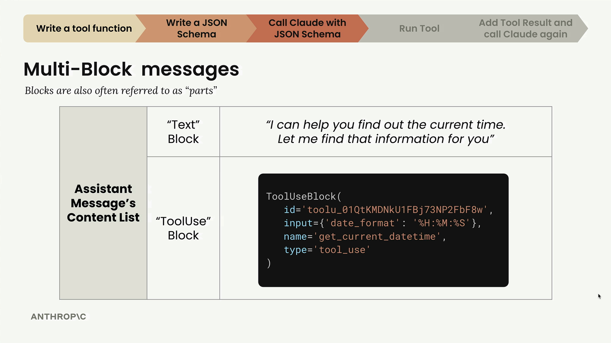

```python
response = client.messages.create(
    model=model,
    max_tokens=1000,
    messages=messages,
    tools=[get_current_datetime_schema],
)
messages.append({"role": "assistant", "content": response.content})
```

### Sending tool results
Run the tool, then send its output back in a `user` message as a `tool_result` block ([[User-vs-Assistant-Messages|why a user message]]):
- `tool_use_id`: the `id` of the `tool_use` block it answers.
- `content`: the tool's output, as a string.
- `is_error`: `True` if the tool failed.

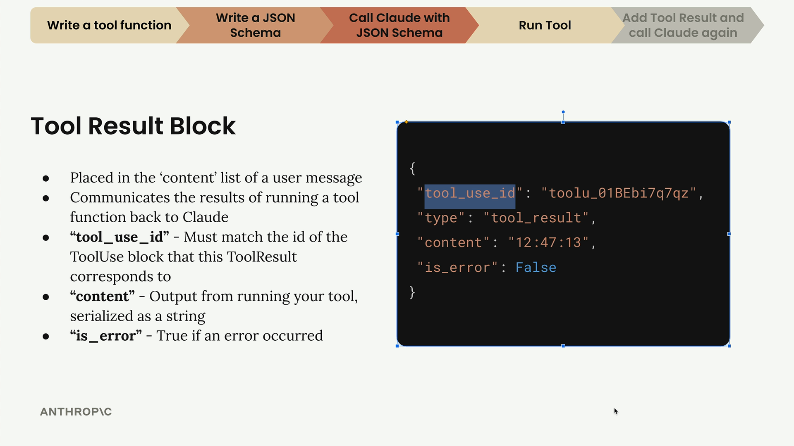

If Claude asks for several tools at once, send all the results together in one user message, matched by ID in any order ([[Agentic-Loop-Message-Cycle#Rules|rules]]).

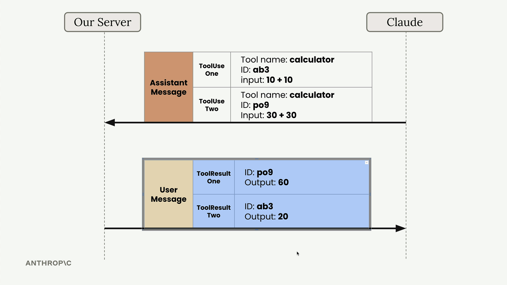

```python
tool_use_block = response.content[1]  # By order: assumes exactly one block comes first
tool_use_block = next(block for block in response.content if block.type == "tool_use")  # By type

messages.append({
    "role": "user",
    "content": [{
        "type": "tool_result",
        "tool_use_id": tool_use_block.id,
        "content": "15:04:22",
        "is_error": False
    }]
})
```

Then call Claude again with the same `tools` and the whole history. Repeat while `stop_reason` is `"tool_use"` ([[Agentic-Loop-Message-Cycle|agentic loop]]).

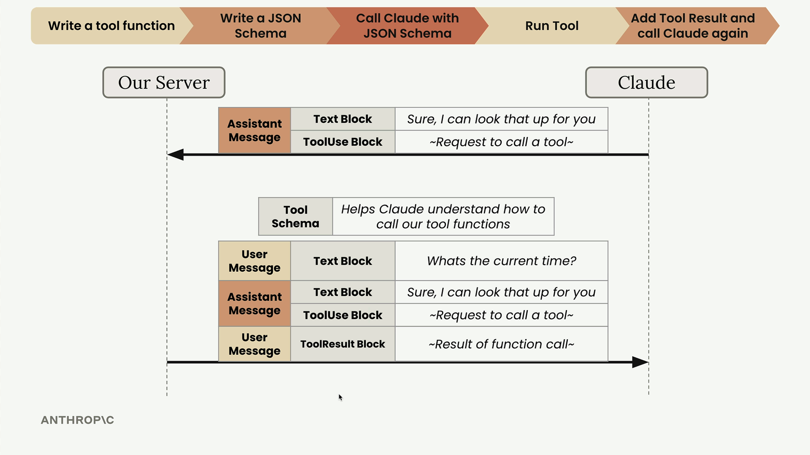

The history at that point, as printed:

```python
[{'role': 'user', 'content': 'What is the exact time, formatted as HH:MM:SS?'},
 {'role': 'assistant',
  'content': [TextBlock(citations=None, text="I'll retrieve the current time for you formatted as HH:MM:SS.", type='text'),
              ToolUseBlock(id='toolu_01BEbi7q7qzvwP8zSMBHp3BD', input={'date_format': '%H:%M:%S'},
                           name='get_current_datetime', type='tool_use')]},
 {'role': 'user',
  'content': [{'type': 'tool_result',
               'tool_use_id': 'toolu_01BEbi7q7qzvwP8zSMBHp3BD',
               'content': '15:04:22',
               'is_error': False}]}]
```

<br>

## Related
---

- [[Agent-SDK-vs-Client-SDK|Agent SDK vs Client SDK]]
- [[Claude-Technologies-Reference#Client SDK|Client SDK (reference)]]
- [[Agentic-Loop-Message-Cycle|Agentic Loop: The Message Cycle]]
- [[Courses-by-Anthropic|Courses by Anthropic]]: course 2, Building with the Claude API
