# Claude API: Anthropic Client SDK

Calling the Claude API from Python with the `anthropic` package, the Client SDK. For how it differs from the Agent SDK, see [[Agent-SDK-vs-Client-SDK|Agent SDK vs Client SDK]].

<br>

## Accessing the API
---

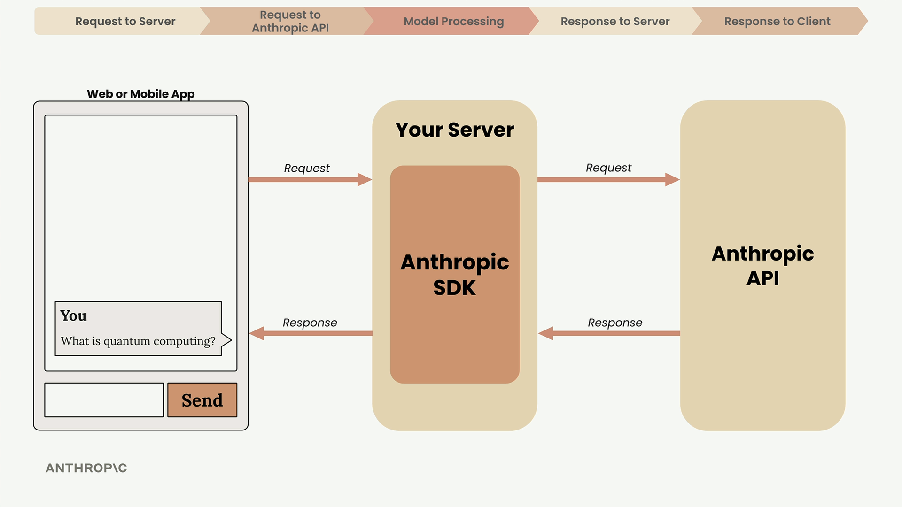

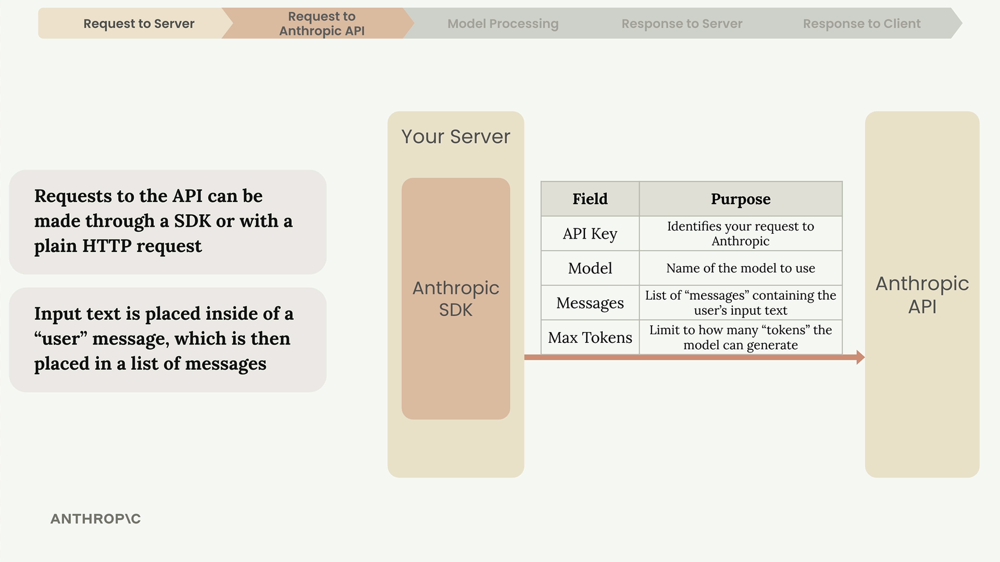

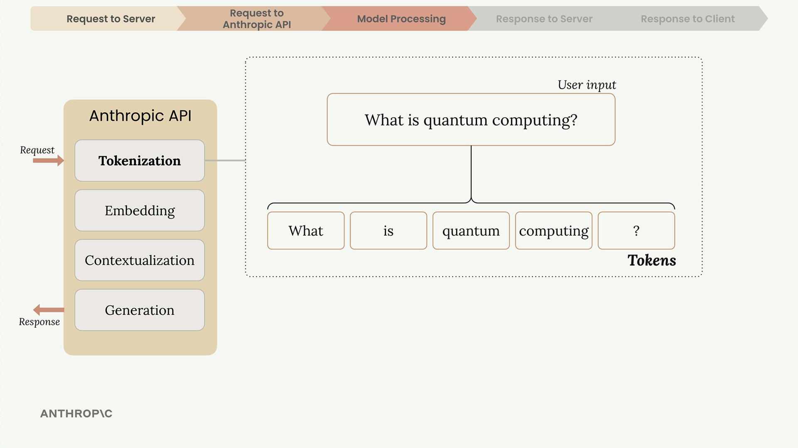

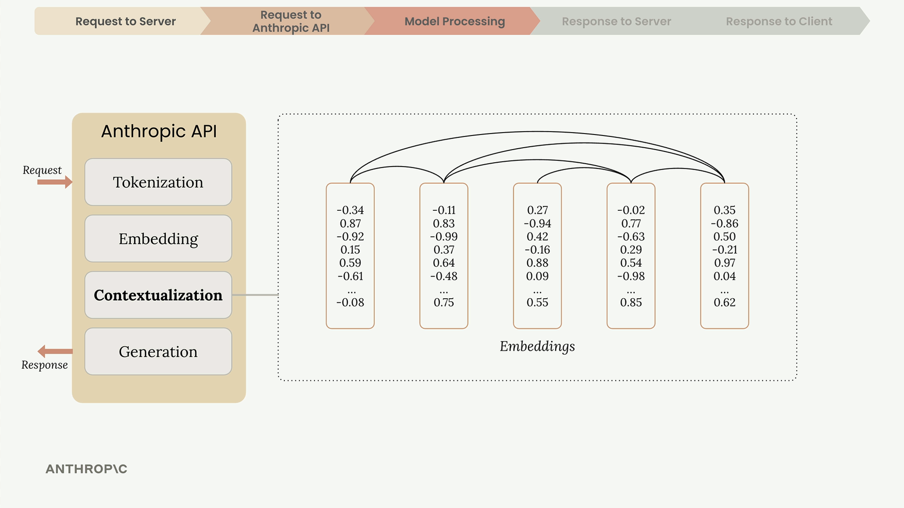

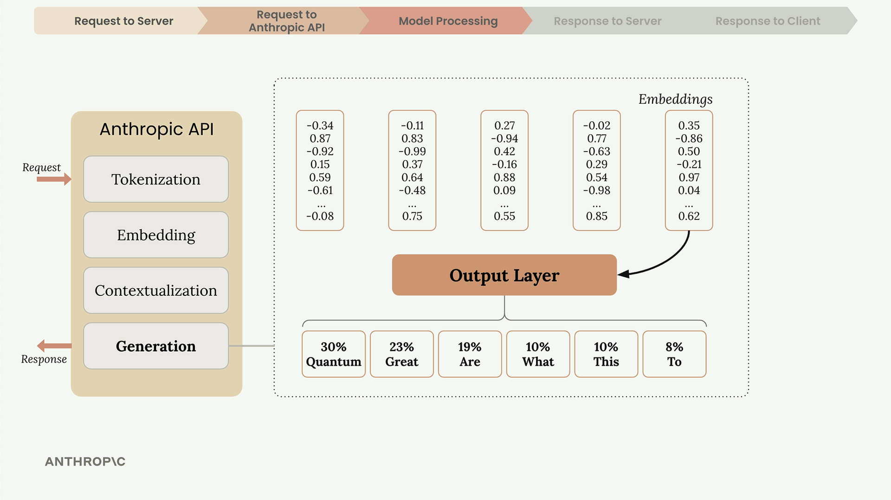

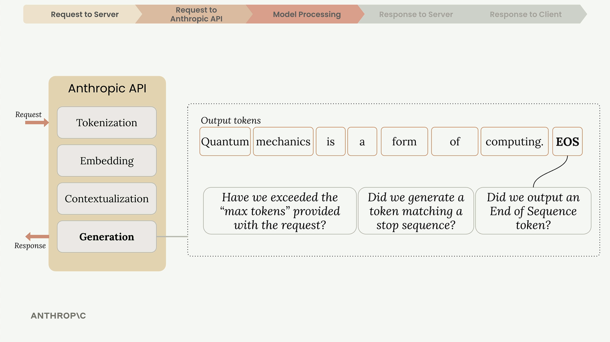

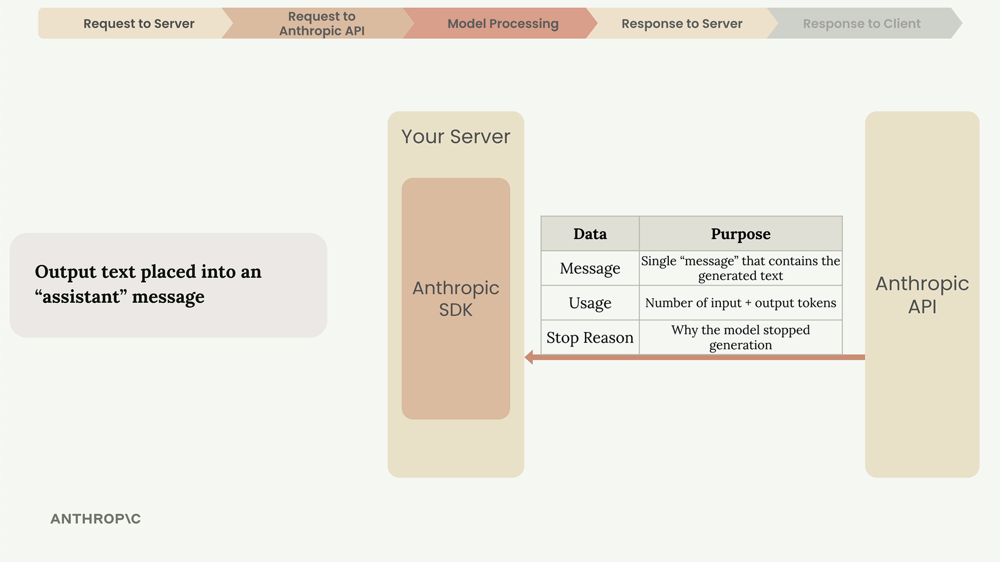

<br>

## Setup
---

Install the SDK and `python-dotenv` (in a notebook cell):

```python
%pip install anthropic python-dotenv
```

Put your key in a `.env` file, and keep that file out of git:

```bash
ANTHROPIC_API_KEY="your-api-key-here"
```

Load it into the environment, where the SDK looks for the key:

```python
from dotenv import load_dotenv
load_dotenv()
```

Create the client, which reads that key, and choose a model:

```python
from anthropic import Anthropic

client = Anthropic()
model = "claude-opus-5-5"
```

<br>

## Making Your First Request
---

Here's a complete example of making a request to Claude:

```python
message = client.messages.create(
    model=model,
    max_tokens=1000,
    messages=[
        {
            "role": "user",
            "content": "What is quantum computing? Answer in one sentence"
        }
    ]
)
```

- `model`: which Claude model answers.
- `max_tokens`: a hard cap on the reply, not a length hint ([[Agentic-Loop-Message-Cycle#^max-tokens-cutoff|why]]).
- `messages`: the conversation so far, here a single `user` message ([[User-vs-Assistant-Messages|roles]]).
- Returns one assistant message: `content`, `stop_reason`, `usage` ([[Claude-Technologies-Reference#Response fields|response fields]]).

<br>

## Extracting the Response
---

`message.content` is a list of [[Claude-Technologies-Reference#Content blocks|content blocks]]. Two ways to get the text:

```python
message.content[0].text  # By order: breaks if a thinking block comes first
next(block.text for block in message.content if block.type == "text")  # By type
```

<br>

## Multi-Turn Conversations
---

The API keeps no memory between calls, so every call sends the whole history ([[Agentic-Loop-Message-Cycle|why]]). Helpers that build the list and send it:

```python
def add_user_message(messages, text):
    user_message = {"role": "user", "content": text}
    messages.append(user_message)

def add_assistant_message(messages, text):
    assistant_message = {"role": "assistant", "content": text}
    messages.append(assistant_message)

def chat(messages):
    message = client.messages.create(
        model=model,
        max_tokens=1000,
        messages=messages,
    )
    return message.content[0].text
```

A follow-up question that relies on the first answer:

```python
messages = []  # Start with an empty message list
add_user_message(messages, "Define quantum computing in one sentence")  # Add the initial user question
answer = chat(messages)  # Get Claude's response
add_assistant_message(messages, answer)  # Add Claude's response to the conversation history
add_user_message(messages, "Write another sentence")  # Add a follow-up question
final_answer = chat(messages)  # Get the follow-up response with full context
```

A basic chat loop on the same helpers (runs until you stop it):

```python
while True:
    user_input = input("> ")  # Get user input
    print(">", user_input)
    add_user_message(messages, user_input)  # Add user input to the list of messages
    answer = chat(messages)  # Call Claude with the 'chat' function
    add_assistant_message(messages, answer)  # Add generated text to the list of messages
    print(answer)  # Print the generated text
```

<br>

## System Prompts
---

`system` is a top-level field, not a message ([[Claude-Technologies-Reference#Request fields|request fields]]). The `chat` helper with a system prompt:

```python
def chat(messages):
    system = """
    You are a patient math tutor.
    Do not directly answer a student's questions.
    Guide them to a solution step by step.
    """
    message = client.messages.create(
        model=model,
        max_tokens=1000,
        messages=messages,
        system=system,
    )
    return message.content[0].text
```

<br>

## Temperature
---

`temperature` (0 to 1) changes how likely each next token is to be picked: low gives predictable output, high gives varied output.

Remember that temperature doesn't guarantee different outputs - it just changes the probability of getting them.

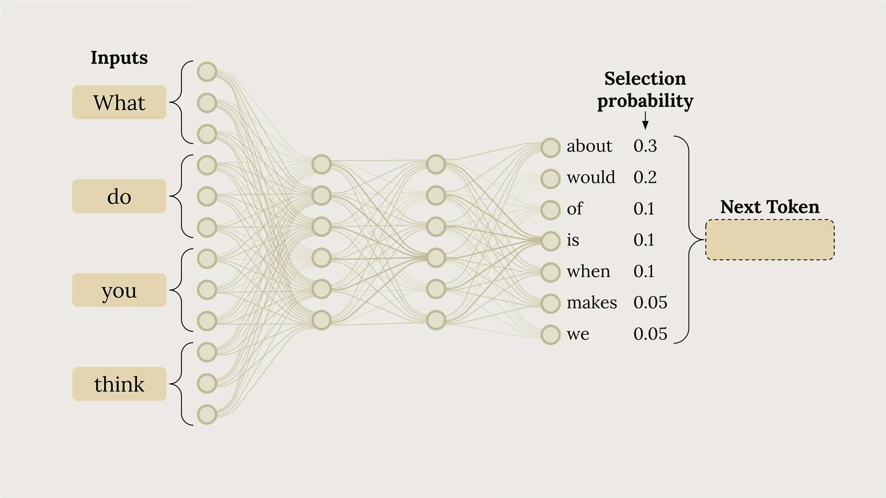

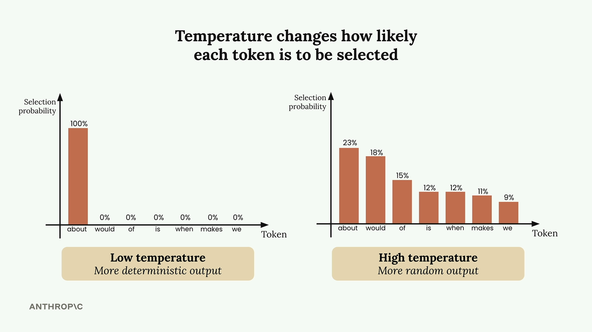

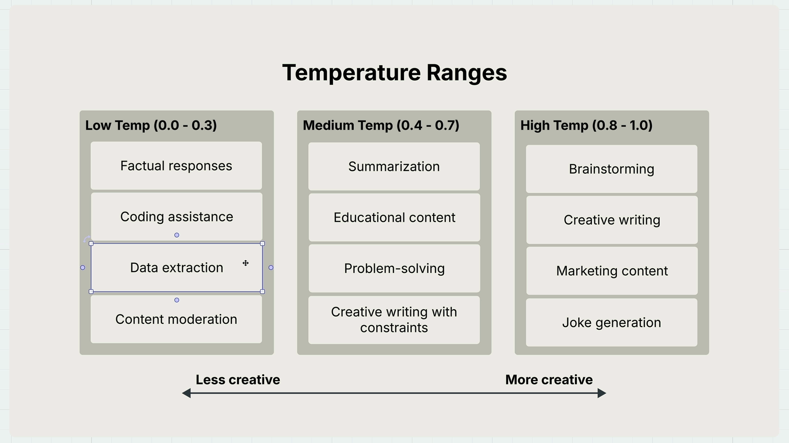

Set it as a request field:

```python
params = {
    "model": model,
    "max_tokens": 1000,
    "messages": messages,
    "temperature": temperature
}
```

Newer models, including `claude-opus-5-5` above, reject `temperature` with a 400 error. It still works on older models such as Claude Sonnet 4.6 with an older SDK.

<br>

## Response Streaming
---

Streaming sends the reply in pieces as it's generated, so the user sees text right away.

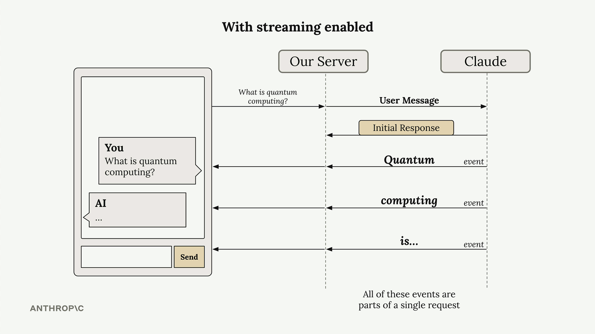

```python
with client.messages.stream(
    model=model,
    max_tokens=1000,
    messages=messages
) as stream:
    for text in stream.text_stream:
        print(text, end="")
        
    final_message = stream.get_final_message()  # Get the complete message for database storage
```

<br>

## Stop Sequences
---

`stop_sequences` ends the reply as soon as Claude writes one of the listed strings. The response then has `stop_reason: "stop_sequence"`.

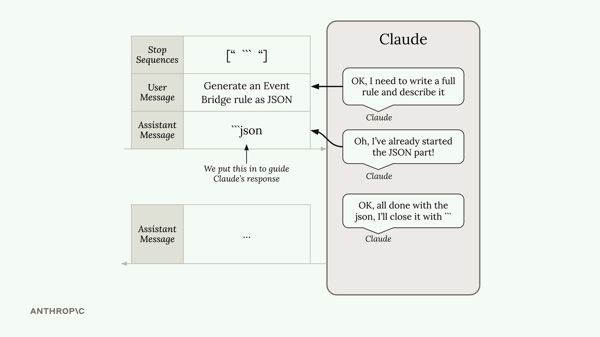

The slide also prefills the assistant message to start the JSON. Current models, including `claude-opus-5-5`, reject a prefill with a 400 error, so for JSON use tool use with a schema ([[JSON-Schema-for-Structured-Extraction|JSON Schema for Structured Extraction]]).

<br>

## Prompt Evaluation
---

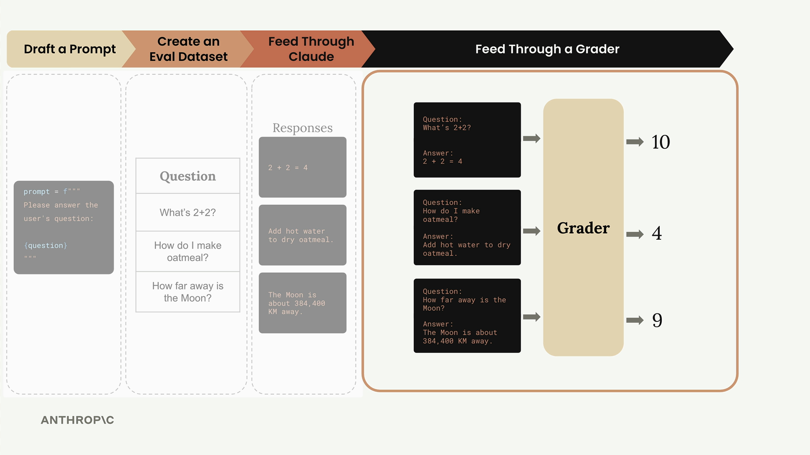

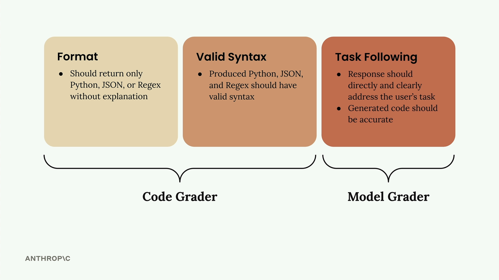

A model grader. It uses the prefill and stop sequence from [[#Stop Sequences|Stop Sequences]], so it needs an older model and a `chat` helper that takes `stop_sequences`.

````python
import json

def grade_by_model(test_case, output):
    # Create evaluation prompt
    eval_prompt = """
    You are an expert code reviewer. Evaluate this AI-generated solution.

    Task: {task}
    Solution: {solution}

    Provide your evaluation as a structured JSON object with:
    - "strengths": An array of 1-3 key strengths
    - "weaknesses": An array of 1-3 key areas for improvement
    - "reasoning": A concise explanation of your assessment
    - "score": A number between 1-10
    """.format(task=test_case["task"], solution=output)

    messages = []
    add_user_message(messages, eval_prompt)
    add_assistant_message(messages, "```json")

    eval_text = chat(messages, stop_sequences=["```"])
    return json.loads(eval_text)
````

<br>

## Related
---

- [[Agent-SDK-vs-Client-SDK|Agent SDK vs Client SDK]]
- [[Claude-Technologies-Reference#Client SDK|Client SDK (reference)]]
- [[Agentic-Loop-Message-Cycle|Agentic Loop: The Message Cycle]]
- [[Courses-by-Anthropic|Courses by Anthropic]]: course 2, Building with the Claude API
