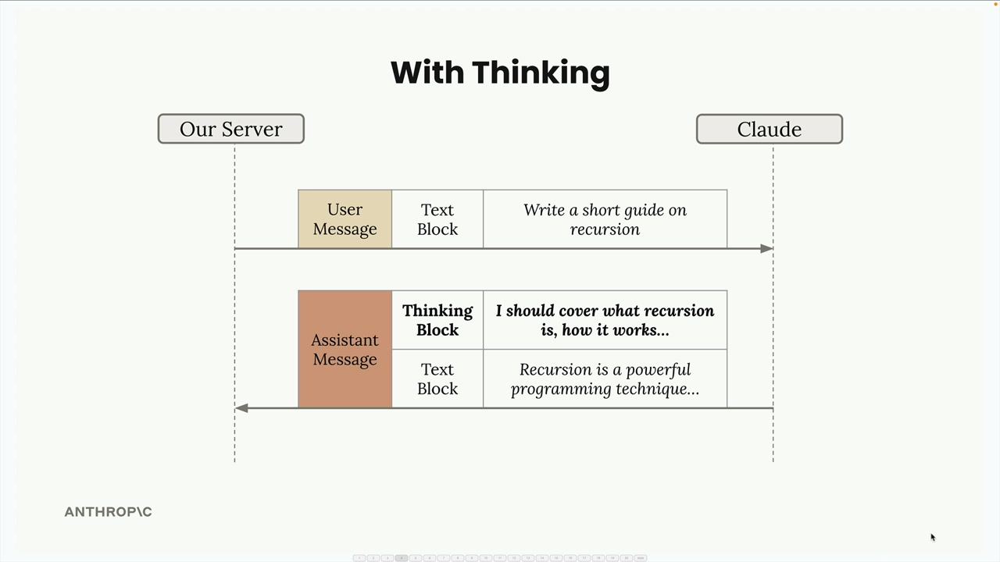
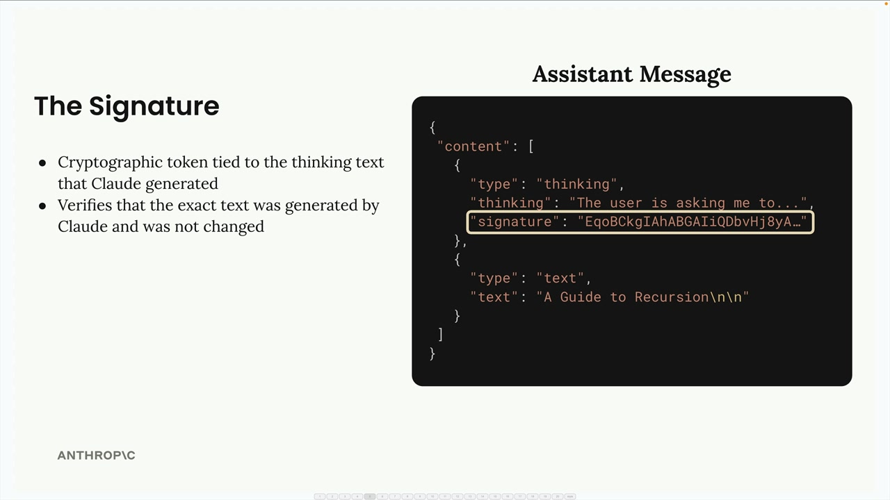
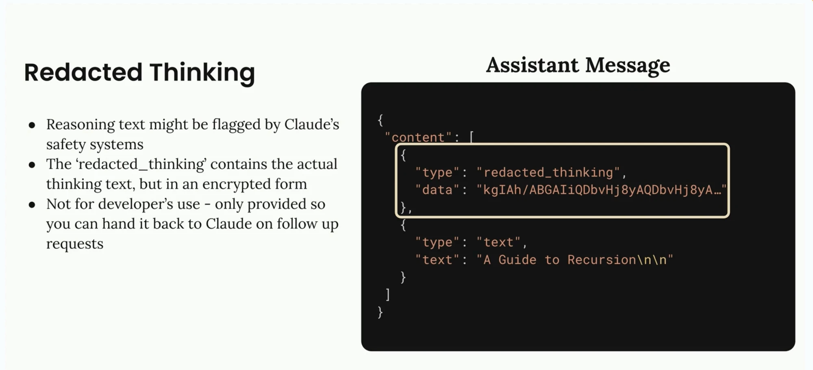
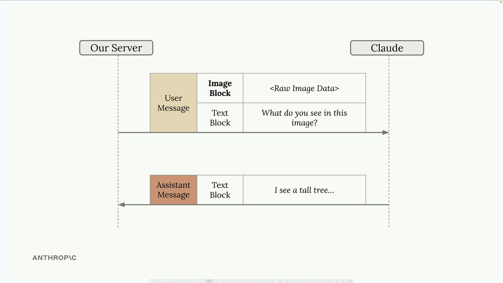
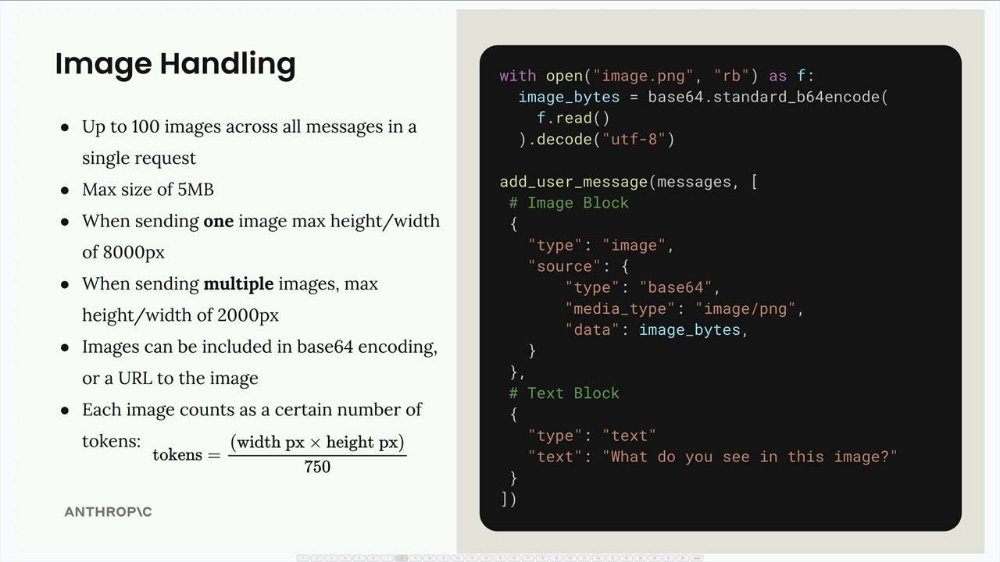
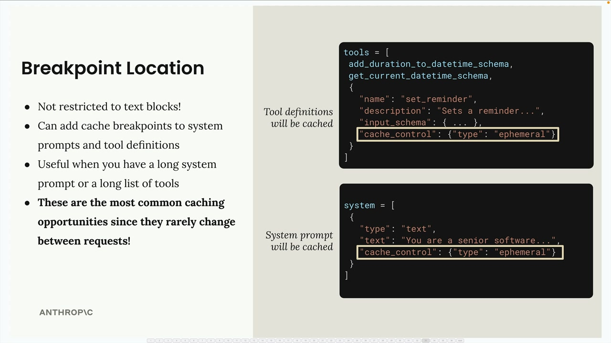
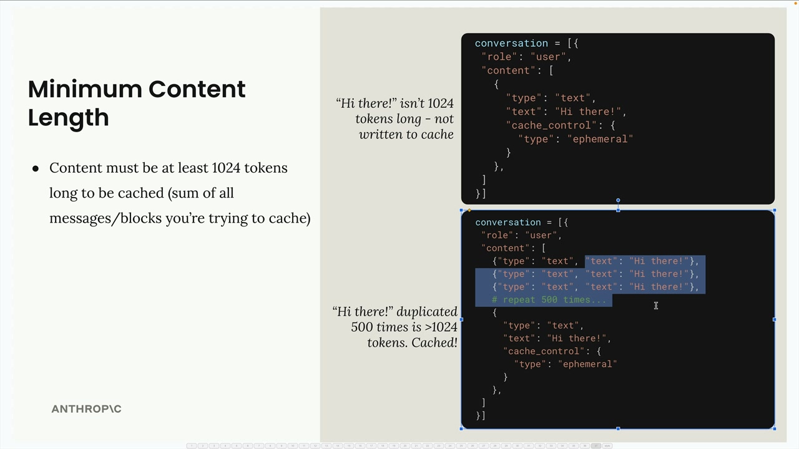
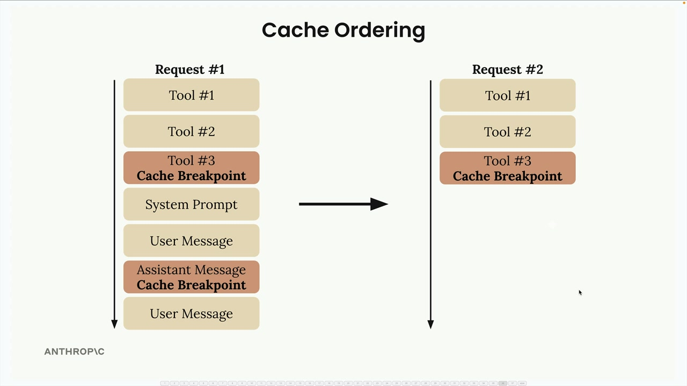

# Features of Claude

← [[Claude-API-RAG|RAG and Agentic Search]] · [[Claude-API-Anthropic-Client-SDK|All chapters]]

<br>

## Extended thinking
---

Claude reasons in a `thinking` block before it writes the answer in a `text` block.



### Signature and redacted thinking




Send both kinds of block back unchanged in later requests, for example in a tool-use loop: the API rejects a thinking block whose text was changed.

### Turning it on
By now the course's `chat` from [[Claude-API-Accessing-Claude#Multi-Turn Conversations|Multi-Turn Conversations]] takes parameters for the earlier features and two for thinking. Its `temperature=1.0` is left out, since `claude-opus-5-5` rejects [[Claude-API-Accessing-Claude#Temperature|temperature]]:

```python
def chat(
    messages,
    system=None,
    stop_sequences=[],
    tools=None,
    thinking=False,
    thinking_budget=1024
): ...
```

`thinking=True` sends `thinking={"type": "enabled", "budget_tokens": thinking_budget}`, a budget of at least 1024 tokens and below `max_tokens`, which older models still take. `claude-opus-5-5` always thinks and rejects a budget with a 400: `output_config.effort` sets how hard it thinks instead. Thinking counts toward `max_tokens`, and its text comes back empty unless you ask for a summary:

```python
message = client.messages.create(
    model=model,
    max_tokens=16000,
    thinking={"type": "adaptive", "display": "summarized"},
    messages=messages,
)
```

Read the reply by block type, since thinking blocks come first ([[Claude-API-Accessing-Claude#Extracting the Response|Extracting the Response]]). On the exam, extended thinking is no substitute for an independent reviewer: a second instance without the first one's reasoning catches more ([[Domain-4-Prompt-Engineering#4.6 Design multi-instance and multi-pass review architectures|Task 4.6]]).

<br>

## Image support
---

An image goes in an `image` block in the user message, next to a `text` block that asks about it.





`add_user_message` is the helper from [[Claude-API-Accessing-Claude#Multi-Turn Conversations|Multi-Turn Conversations]], here passed a list of blocks instead of a string:

```python
with open("image.png", "rb") as image_file:
    image_bytes = base64.standard_b64encode(image_file.read()).decode("utf-8")

add_user_message(messages, [
    # Image Block
    {
        "type": "image",
        "source": {
            "type": "base64",
            "media_type": "image/png",
            "data": image_bytes,
        }
    },
    # Text Block
    {
        "type": "text",
        "text": "What do you see in this image?"
    }
])
```

For an image on the web, the `source` is `{"type": "url", "url": "https://…"}` instead.

Some limits have moved since the slide: on the Claude API, `claude-opus-5-5` takes up to 600 images of 10 MB each (base64), the smaller size cap applies only above 20 images, and an image costs one token per 28×28-pixel patch, with anything over 2,576 px on the long edge or 4,784 tokens scaled down first. Vision is out of scope for the exam.

<br>

## PDF support
---

A PDF goes in a `document` block, with the same base64 or URL `source` as an image. Claude gets each page's text and an image of the page, so it can read charts and tables too.

```python
with open("earth.pdf", "rb") as pdf_file:
    file_bytes = base64.standard_b64encode(pdf_file.read()).decode("utf-8")

messages = []

add_user_message(
    messages,
    [
        {
            "type": "document",
            "source": {
                "type": "base64",
                "media_type": "application/pdf",
                "data": file_bytes,
            },
        },
        {"type": "text", "text": "Summarize the document in one sentence"},
    ],
)

chat(messages)
```

[[Scenario-6-Structured-Extraction|Scenario 6]] extracts structured data from documents like this one.

### Citations
Give the document block a `title` and turn on `citations`:

```python
{
    "type": "document",
    "source": {
        "type": "base64",
        "media_type": "application/pdf",
        "data": file_bytes,
    },
    "title": "earth.pdf",
    "citations": { "enabled": True }
}
```


Claude's answer then comes back as several `text` blocks, and each cited claim carries a `citations` list with these fields. `end_page_number` is exclusive, so 4 to 5 means page 4 only.

Plain text goes straight into the `source`, and its citations give `start_char_index` and `end_char_index` instead of pages:

```python
{
    "type": "document",
    "source": {
        "type": "text",
        "media_type": "text/plain",
        "data": article_text,
    },
    "title": "earth_article",
    "citations": { "enabled": True }
}
```

Either way, each claim stays tied to its source, the same pairing [[Preserving-Attribution|Preserving Attribution]] keeps when agents hand findings on.

<br>

## Prompt caching
---

Before it writes a word, Claude tokenizes the prompt, embeds each token and adds context from the text around it ([[Claude-API-Accessing-Claude#Accessing the API|Accessing the API]]). That work is normally thrown away after the request. Prompt caching keeps it, so a later request that starts with the same content skips it and runs faster and cheaper.


`"cache_control": {"type": "ephemeral"}` on a block sets a cache breakpoint: everything up to and including that block is cached. A text block needs its long form, a dict with `type` and `text`, to take the field.





The minimum has moved since the slide and depends on the model: 512 tokens on `claude-opus-5-5`, 1,024 to 4,096 on older ones. Anything shorter just isn't cached, with no error.



A request is joined in the order tools, system prompt, messages, and a cache hit needs everything up to the breakpoint to match exactly: change one block and the cache misses from that block on. Each breakpoint writes its own cache entry, so request 2 still reuses the cached tools when its system prompt or messages change.

A cache lasts 5 minutes and each use resets the clock; `"ttl": "1h"` keeps it an hour at a higher write price. A request takes up to 4 breakpoints. The response's `usage` counts `cache_creation_input_tokens`, written at 1.25× the input price, and `cache_read_input_tokens`, read at a tenth of it or less.

For the exam, just know caching exists ([[Claude-Technologies-Reference#Prompt caching|Prompt caching]]).

<br>

## Files API
---

Upload a file once, then refer to it by its id instead of sending its bytes in every request.


```python
file_metadata = upload('streaming.csv')
```

`upload` is the course's helper, and `file_metadata.id` then goes in an `image`, `document` or `container_upload` block. The Files API has moved since the course: it's out of beta, so the SDK call is `client.files.upload(...)` with no beta header. The exam guide doesn't name the Files API.

<br>

## Code execution
---

A server tool: Claude writes code and runs it in a sandbox on Anthropic's servers, and the code, its output and the answer all come back in one response.


A `container_upload` block puts a file from the [[#Files API|Files API]] into that sandbox for the code to read:


```python
messages = []
add_user_message(
    messages,
    [
        {
            "type": "text",
            "text": """Run a detailed analysis to determine major drivers of churn.
            Your final output should include at least one detailed plot summarizing your findings."""
        },
        {"type": "container_upload", "file_id": file_metadata.id},
    ],
)

chat(
    messages,
    tools=[{"type": "code_execution_20250522", "name": "code_execution"}]
)

download_file("file_id_from_response")
```


A file the code saves, such as the plot, comes back as a `file_id` in the tool result, and `download_file` fetches it through the Files API. Only files Claude creates can be downloaded, not ones you upload.

The tool has moved since the course: the current type is `code_execution_20260521`, which runs Bash as well as Python and needs no beta header, and a command's result comes back as a `bash_code_execution_tool_result` block.

On the exam, it's one of the server tools: you only list it in `tools`, Anthropic runs it, and your code sends no `tool_result` ([[Claude-Technologies-Reference#Server tools|Server tools]]).
