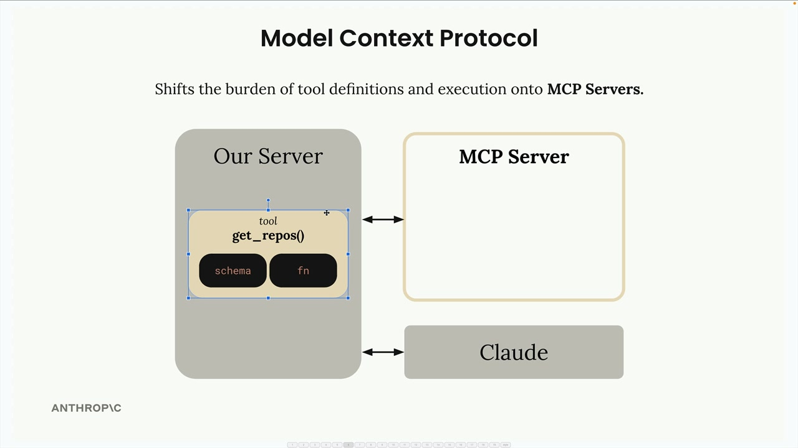
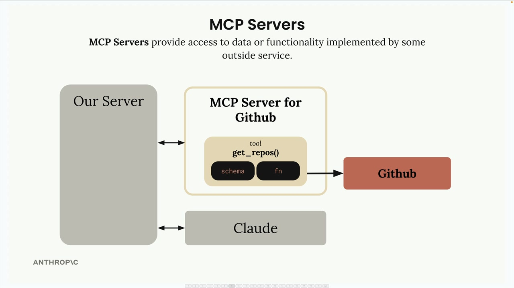
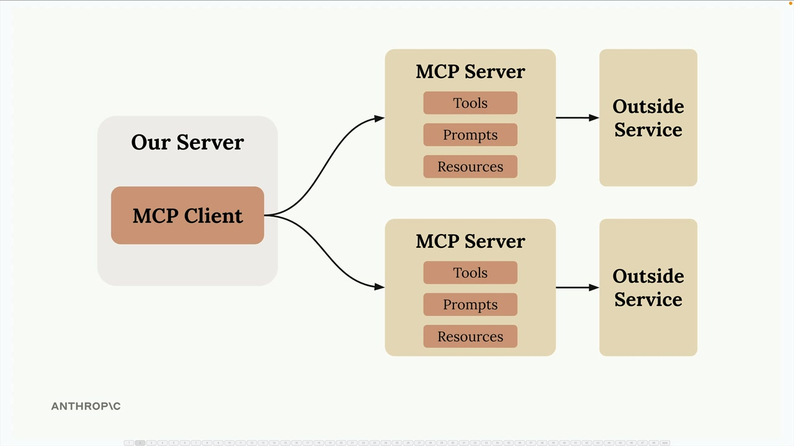
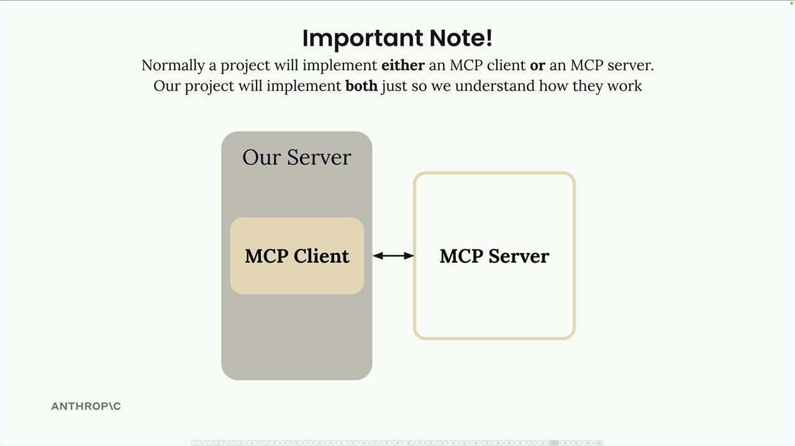
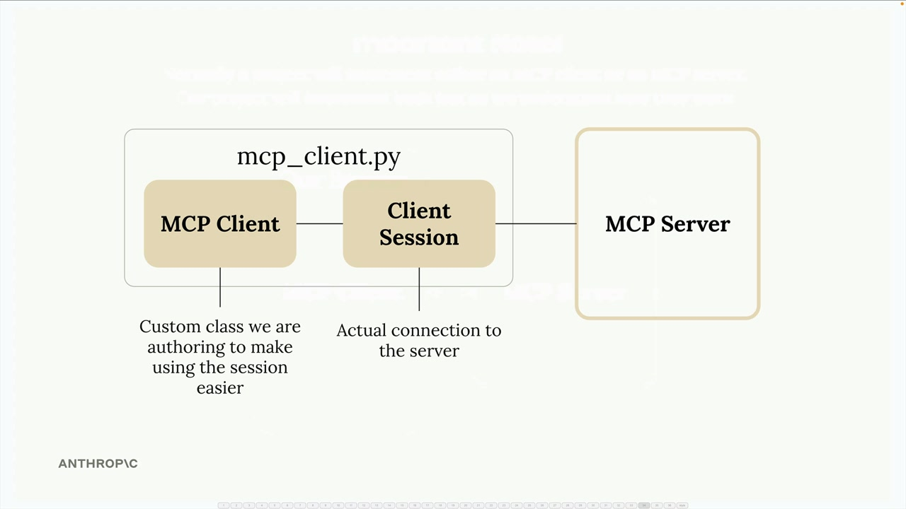
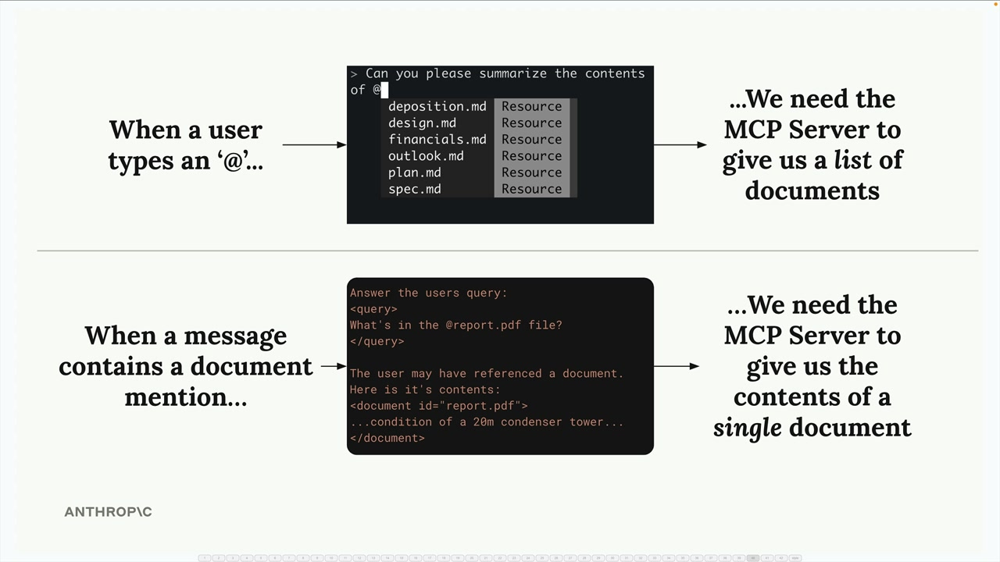
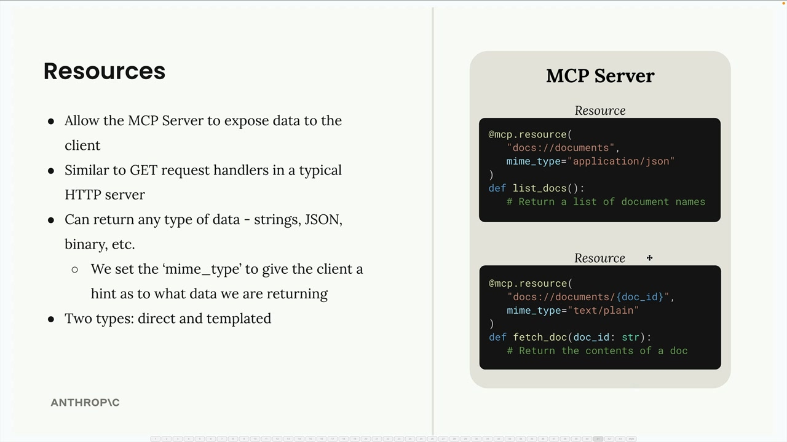
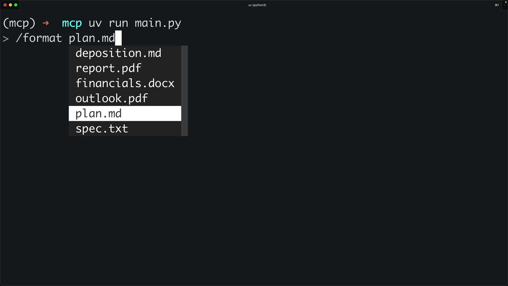
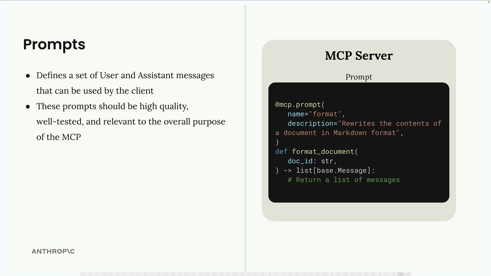
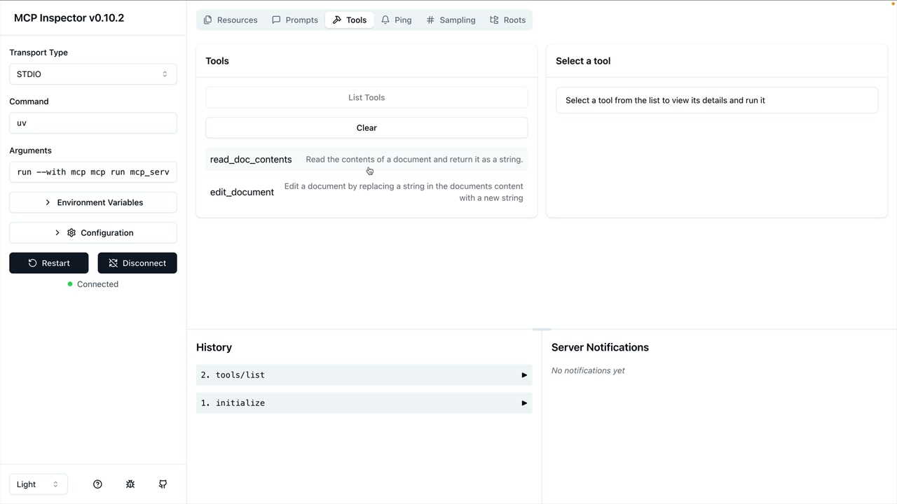

# Model Context Protocol

← [[Claude-API-Features-of-Claude|Features of Claude]] · [[Claude-API-Anthropic-Client-SDK|All chapters]]

MCP is a communication layer that gives Claude tools and context without you writing all the tool code yourself. Each primitive below shows the server side, then the client side (prompts: server side only so far).

<br>

## Why MCP
---



Without MCP, our server holds every tool's schema and function: for Claude to work with GitHub, we'd write and maintain a tool for each action (repos, pull requests, issues, …).



An MCP server is an ordinary program, no AI inside. Anyone can write one, and services often publish an official one. MCP doesn't replace tool use: Claude still asks for a tool and our server still sends back the result. MCP only moves who writes and runs the tool.





On the exam: where to configure servers (`.mcp.json` or `~/.claude.json`) and when to build your own ([[Domain-2-Tool-Design-and-MCP#2.4 Integrate MCP servers into Claude Code and agent workflows|Task 2.4]], [[Claude-Technologies-Reference#MCP (Model Context Protocol)|MCP reference]]).

> [!tip] Exam tip
> For a standard integration like Jira or GitHub, use the existing community MCP server. Build a custom one only for a workflow specific to your team.

^exam-tip

<br>

## Client and server
---





With the Python SDK (`mcp`), `mcp_server.py` serves documents kept in a dict, `docs` (document id → text), and `MCPClient` starts that server as a subprocess and talks to it over stdio.

Has moved since the course: SDK v2 adds `Client` (`from mcp import Client`), which connects to a server's URL or starts a local one over stdio with no wrapper of your own. Result fields are snake_case in Python (`is_error`, `input_schema`, `mime_type`).

On the exam: no SDK code. Claude Code and the Agent SDK have the client built in, so you only configure servers (`.mcp.json`, `mcp_servers`) ([[Domain-2-Tool-Design-and-MCP#2.4 Integrate MCP servers into Claude Code and agent workflows|Task 2.4]]).

<br>

## Tools
---


Claude never talks to the MCP server: our server stays in the loop, as in [[Claude-API-Tool-Use|plain tool use]]. On the wire, ListToolsRequest is `tools/list` and CallToolRequest is `tools/call`.

On the exam: tools from every configured server are found at connection time and are all available at once, and the description decides whether the agent picks a tool over a built-in like Grep ([[Domain-2-Tool-Design-and-MCP#2.4 Integrate MCP servers into Claude Code and agent workflows|Task 2.4]]). A failed call needs `errorCategory`, `isRetryable` and a readable message, not just an error string ([[Domain-2-Tool-Design-and-MCP#2.2 Implement structured error responses for MCP tools|Task 2.2]]).

### Defining tools
Two tools, `read_doc_contents` and `edit_document`, each a decorated function:

```python
from mcp.server.fastmcp import FastMCP
from pydantic import Field

mcp = FastMCP("DocumentMCP", log_level="ERROR")

@mcp.tool(
    name="read_doc_contents",
    description="Read the contents of a document and return it as a string."
)
def read_document(
    doc_id: str = Field(description="Id of the document to read")
):
    if doc_id not in docs:
        raise ValueError(f"Doc with id {doc_id} not found")

    return docs[doc_id]
```

No hand-written JSON schema as in [[Claude-API-Tool-Use#Tool schemas|Tool Use]]: the SDK builds it from the decorator's `name` and `description`, the type hints and each argument's `Field(description=…)`. A raised error reaches the client as a tool result with `isError` set.

Has moved since the course: SDK v2 renamed `FastMCP` to `MCPServer` (`from mcp.server import MCPServer`), and the `mcp.server.fastmcp` import fails there. The decorators and `log_level` are unchanged.

### Listing and calling tools
The client's two tool methods just forward to the `ClientSession`:

```python
async def list_tools(self) -> list[types.Tool]:
    result = await self.session().list_tools()
    return result.tools

async def call_tool(
    self, tool_name: str, tool_input: dict
) -> types.CallToolResult | None:
    return await self.session().call_tool(tool_name, tool_input)
```

`list_tools` fetches the tools our server sends to Claude, and `call_tool` runs the one Claude asked for. To test, run `mcp_client.py` directly; its harness starts the server and prints its tools:

```python
async with MCPClient(
    command="uv", args=["run", "mcp_server.py"]
) as client:
    result = await client.list_tools()
    print(result)
```

<br>

## Resources
---



Claude never asks for a resource the way it asks for a tool: our app reads it by URI and puts the content in the prompt, as in the slide's `<document>` tag.

On the exam: resources expose a content catalog (issue summaries, a documentation tree, database schemas) so the agent needs fewer exploratory tool calls ([[Domain-2-Tool-Design-and-MCP#2.4 Integrate MCP servers into Claude Code and agent workflows|Task 2.4]]).

### Defining resources


A direct resource has a fixed URI and lists the documents:

```python
@mcp.resource(
    "docs://documents",
    mime_type="application/json"
)
def list_docs() -> list[str]:
    return list(docs.keys())
```

A templated resource has a parameter in its URI, which the SDK passes to the function, and fetches one document:

```python
@mcp.resource(
    "docs://documents/{doc_id}",
    mime_type="text/plain"
)
def fetch_doc(doc_id: str) -> str:
    if doc_id not in docs:
        raise ValueError(f"Doc with id {doc_id} not found")
    return docs[doc_id]
```

### Reading resources


`docs://documents` browses the document names for the `@` autocomplete, `docs://documents/report.pdf` fetches one document for the prompt. `read_resource` sends the ReadResourceRequest (`resources/read` on the wire) and uses the server's `mime_type` to decide how to parse what comes back:

```python
async def read_resource(self, uri: str) -> Any:
    result = await self.session().read_resource(AnyUrl(uri))
    resource = result.contents[0]

    if isinstance(resource, types.TextResourceContents):
        if resource.mimeType == "application/json":
            return json.loads(resource.text)

    return resource.text
```

Has moved since the course: in SDK v2, `read_resource()` takes the URI as a plain `str`, no `AnyUrl`.

<br>

## Prompts
---

The user runs a prompt as a slash command:



Claude Code lists an MCP server's prompts as slash commands too, `/mcp__<server>__<prompt>`.

On the exam: MCP prompts aren't in the exam guide, so they're out of scope.

### Defining prompts


`format_document` returns one `base.UserMessage`: an instruction to rewrite the document as Markdown with `edit_document`, with `doc_id` filled in.

Has moved since the course: in SDK v2, `base` (`from mcp.server.fastmcp.prompts import base`) imports from `mcp.server.mcpserver.prompts`.

<br>

## The server inspector
---

```bash
mcp dev mcp_server.py
```

Opens the MCP Inspector in the browser, to try the server without Claude or a client: Connect, List Tools, pick one, fill in its arguments and run it.



History logs each request the inspector sent, `initialize` first.

Has moved since the slide: the 2026-07-28 MCP spec deprecates Sampling and Roots (two of the tabs), and logging. They still work with servers on older spec versions.

The inspector is out of scope for the exam.
