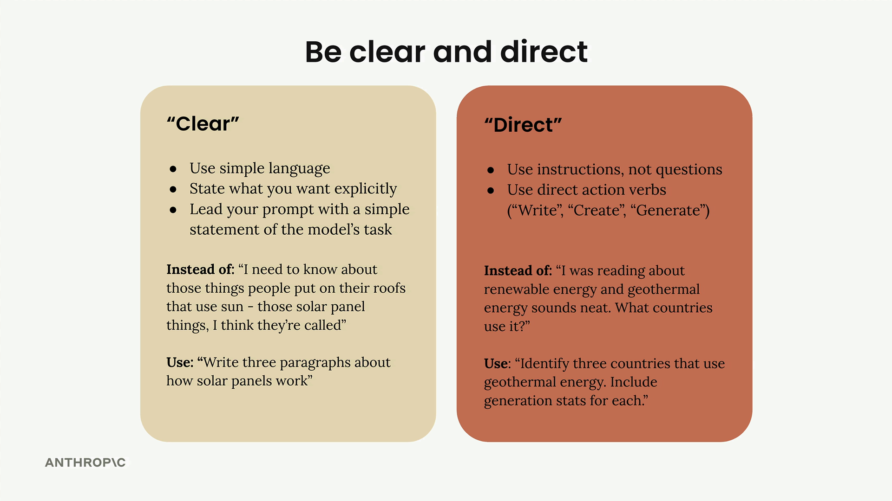
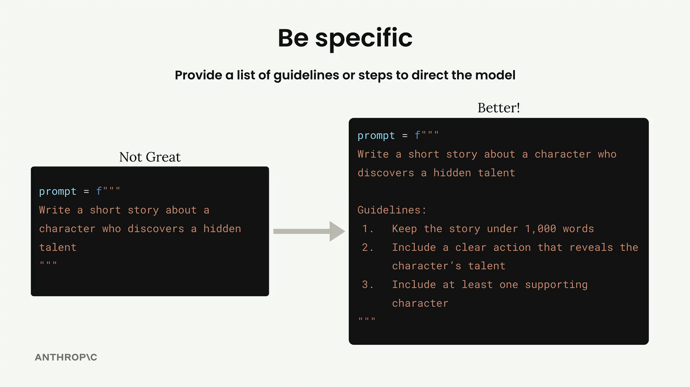
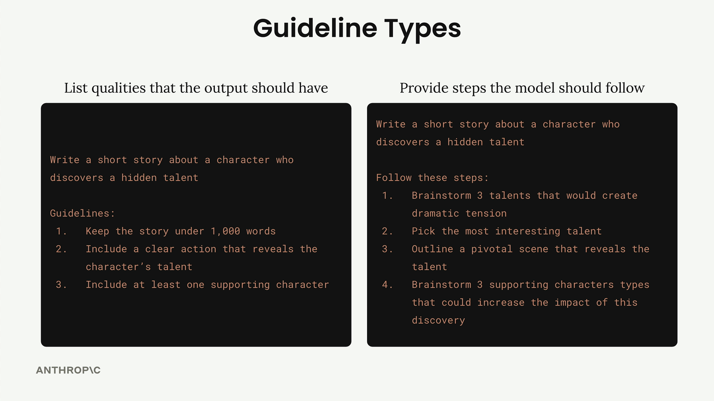
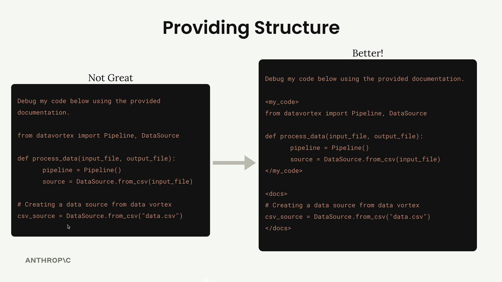

# Prompt Engineering Techniques

← [[Claude-API-Prompt-Evaluation|Prompt Evaluation]] · [[Claude-API-Anthropic-Client-SDK|All chapters]] · [[Claude-API-Tool-Use|Tool Use with Claude]] →

Writing prompts that get the output you want on the first try. On the exam, this is [[Domain-4-Prompt-Engineering|Domain 4]] (20%).

 

## Be clear and direct
---

- Open with one plain sentence that states the task.
- Give an instruction, not a question, and start it with an action verb: "Write", "Create", "Identify".

 

## Be specific
---

Add a list of guidelines under the task. They come in two kinds:
- **Qualities** the output should have, such as a length limit or what it must include.
- **Steps** Claude should follow to get there, such as brainstorming options and then picking one.

Explicit criteria like these are what [[Domain-4-Prompt-Engineering#4.1 Design prompts with explicit criteria to improve precision and reduce false positives|Task 4.1]] tests.

 

## Structure with XML tags
---

Wrap each piece of content in its own tag, such as `<my_code>` and `<docs>`. Claude can then tell your instruction apart from the material it works on, and one piece of material from another. The tag names are up to you: pick ones that describe the content.

