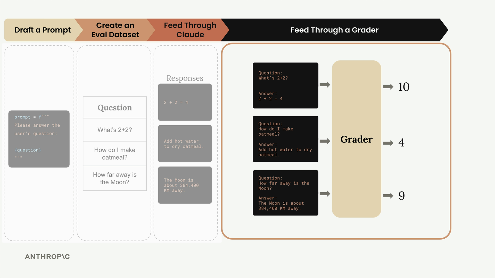
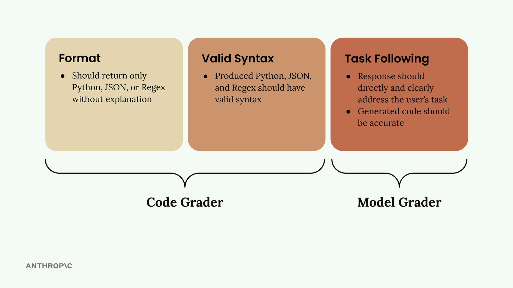
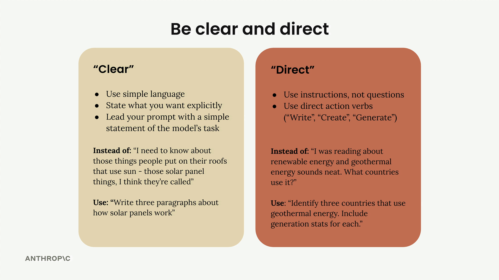
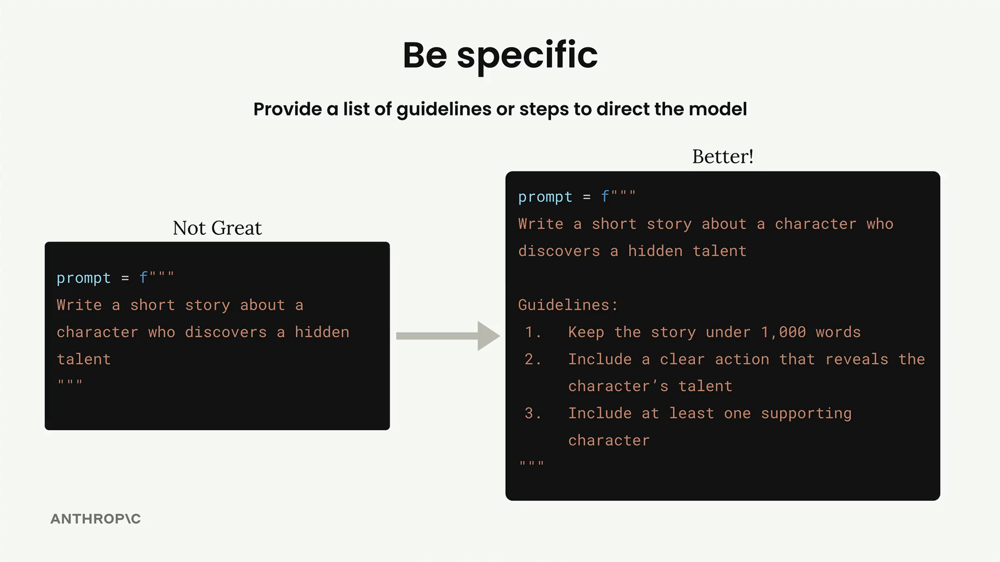
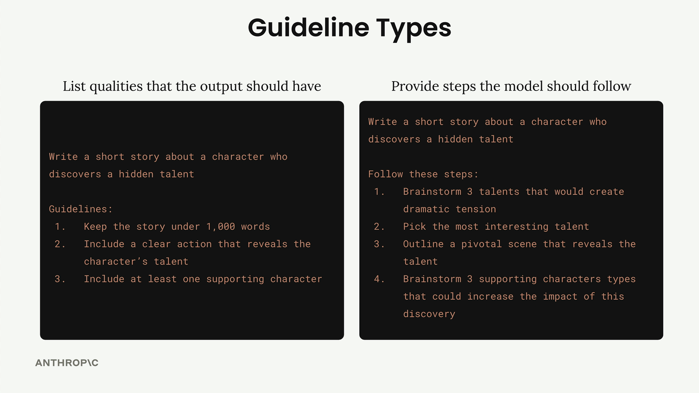
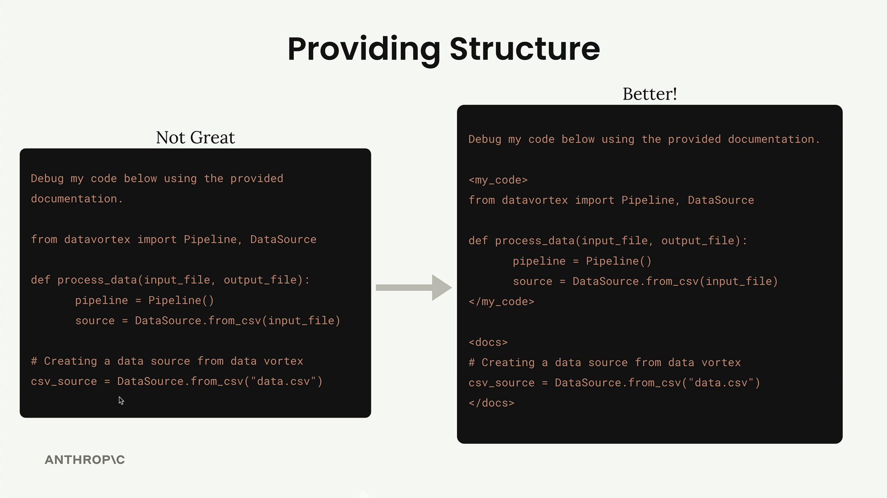

# Prompt Evaluation and Engineering

← [[Claude-API-Accessing-Claude|Accessing Claude with the API]] · [[Claude-API-Anthropic-Client-SDK|All chapters]] · [[Claude-API-Tool-Use|Tool Use with Claude]] →

Two course chapters in one note: how to measure a prompt, then techniques that improve it.

<br>

## Prompt Evaluation
---

### The eval workflow


### Grading


A model grader. It uses the prefill and stop sequence from [[Claude-API-Accessing-Claude#Stop Sequences|Stop Sequences]], so it needs an older model and a `chat` helper that takes `stop_sequences`.

````python
import json

def grade_by_model(test_case, output):
    # Create evaluation prompt
    eval_prompt = """
    You are an expert code reviewer. Evaluate this AI-generated solution.

    Task: {task}
    Solution: {solution}

    Provide your evaluation as a structured JSON object with:
    - "strengths": An array of 1-3 key strengths
    - "weaknesses": An array of 1-3 key areas for improvement
    - "reasoning": A concise explanation of your assessment
    - "score": A number between 1-10
    """.format(task=test_case["task"], solution=output)

    messages = []
    add_user_message(messages, eval_prompt)
    add_assistant_message(messages, "```json")

    eval_text = chat(messages, stop_sequences=["```"])
    return json.loads(eval_text)
````

<br>

## Prompt Engineering
---

Writing prompts that get the output you want on the first try. On the exam, this is [[Domain-4-Prompt-Engineering|Domain 4]] (20%).

### Be clear and direct
- Open with one plain sentence that states the task.
- Give an instruction, not a question, and start it with an action verb: "Write", "Create", "Identify".



### Be specific
Add a list of guidelines under the task. They come in two kinds:
- **Qualities** the output should have, such as a length limit or what it must include.
- **Steps** Claude should follow to get there, such as brainstorming options and then picking one.

Explicit criteria like these are what [[Domain-4-Prompt-Engineering#4.1 Design prompts with explicit criteria to improve precision and reduce false positives|Task 4.1]] tests.





### Structure with XML tags
Wrap each piece of content in its own tag, such as `<my_code>` and `<docs>`. Claude can then tell your instruction apart from the material it works on, and one piece of material from another. The tag names are up to you: pick ones that describe the content.


