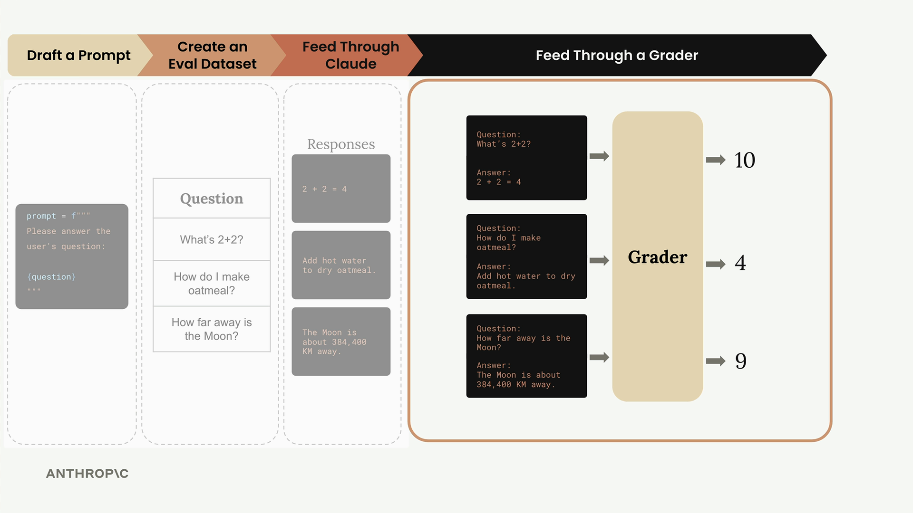
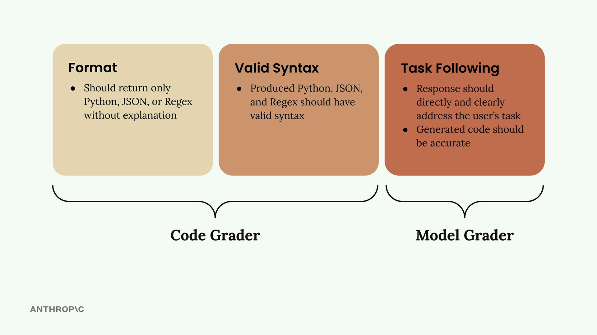

# Prompt Evaluation

← [[Claude-API-Accessing-Claude|Accessing Claude with the API]] · [[Claude-API-Anthropic-Client-SDK|All chapters]] · [[Claude-API-Prompt-Engineering|Prompt Engineering Techniques]] →

<br>

## The eval workflow
---



<br>

## Grading
---



A model grader. It uses the prefill and stop sequence from [[Claude-API-Accessing-Claude#Stop Sequences|Stop Sequences]], so it needs an older model and a `chat` helper that takes `stop_sequences`.

````python
import json

def grade_by_model(test_case, output):
    # Create evaluation prompt
    eval_prompt = """
    You are an expert code reviewer. Evaluate this AI-generated solution.

    Task: {task}
    Solution: {solution}

    Provide your evaluation as a structured JSON object with:
    - "strengths": An array of 1-3 key strengths
    - "weaknesses": An array of 1-3 key areas for improvement
    - "reasoning": A concise explanation of your assessment
    - "score": A number between 1-10
    """.format(task=test_case["task"], solution=output)

    messages = []
    add_user_message(messages, eval_prompt)
    add_assistant_message(messages, "```json")

    eval_text = chat(messages, stop_sequences=["```"])
    return json.loads(eval_text)
````
