# RAG and Agentic Search

← [[Claude-API-Tool-Use|Tool Use with Claude]] · [[Claude-API-Anthropic-Client-SDK|All chapters]]

Retrieval Augmented Generation (RAG): split a long document into chunks, find the chunks closest to the user's question, and put only those in the prompt.

> [!tip] Exam tip
> Embedding models and vector database details are out of scope for the exam. Chunking does come up: a document too big for the context window is split before it's resubmitted, for example a failed batch item ([[Message-Batches-API|Message Batches API]], [[Domain-4-Prompt-Engineering#4.5 Design efficient batch processing strategies|Task 4.5]]).

^exam-tip

<br>

## The idea
---

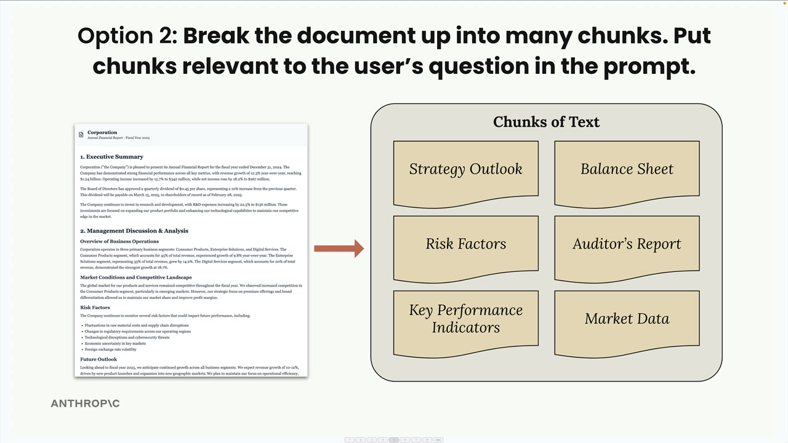

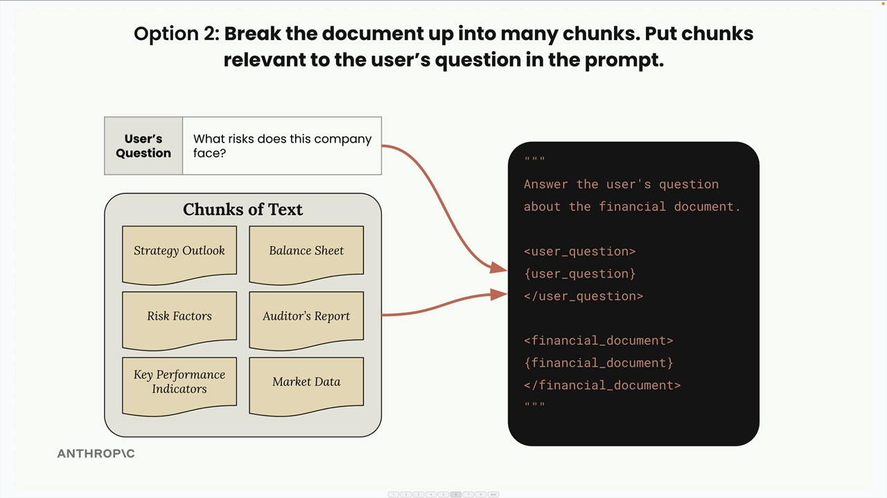

Option 1, the whole document in every prompt, runs into the context limit, costs more, and [[Inference-Next-Token-Prediction#^attention-dilution|spreads Claude's attention thinner]].

<br>

## Chunking
---

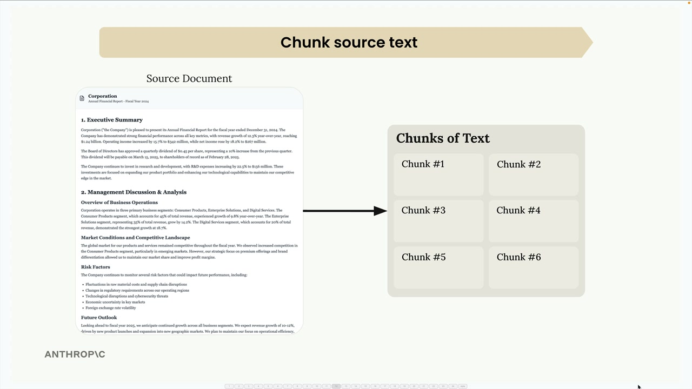

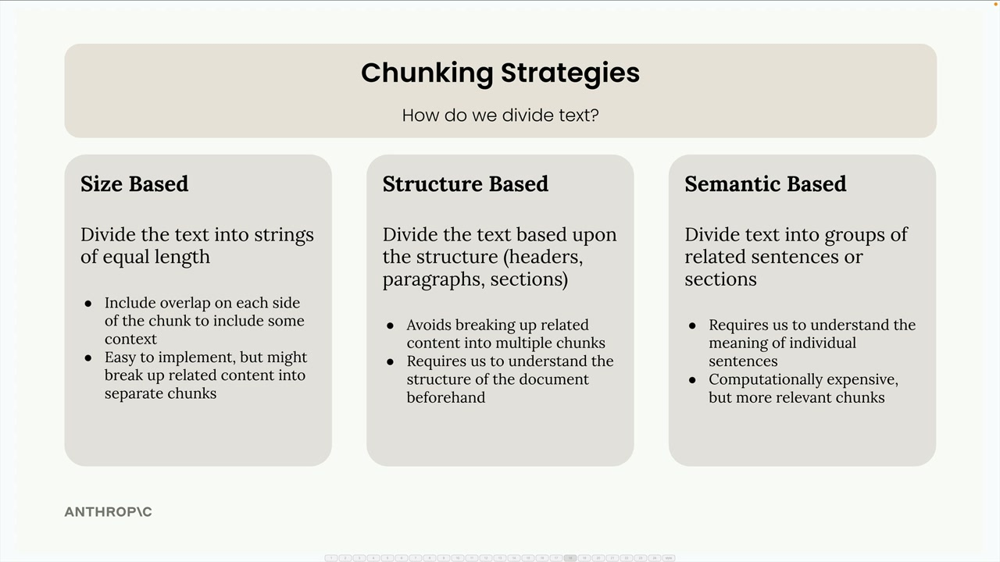

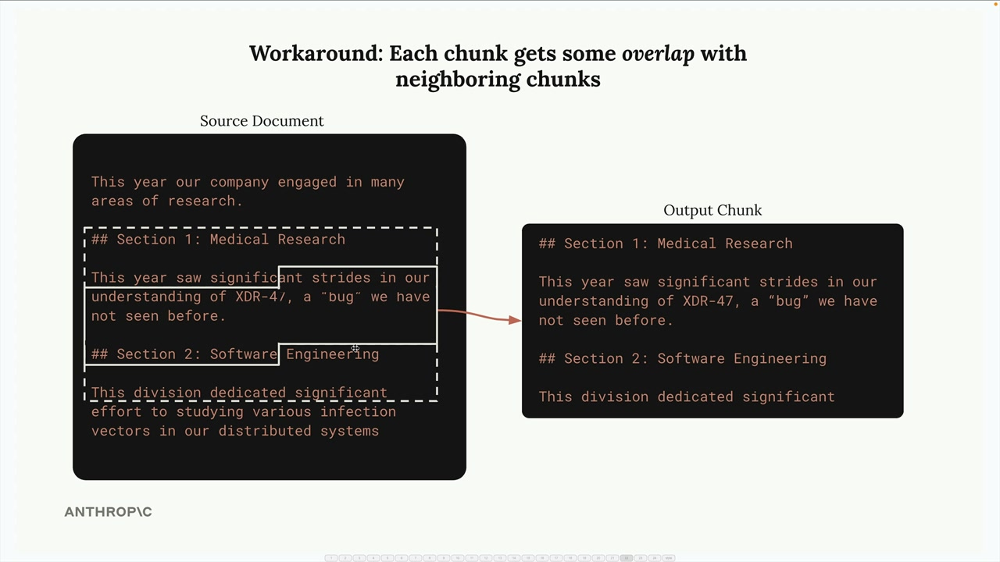

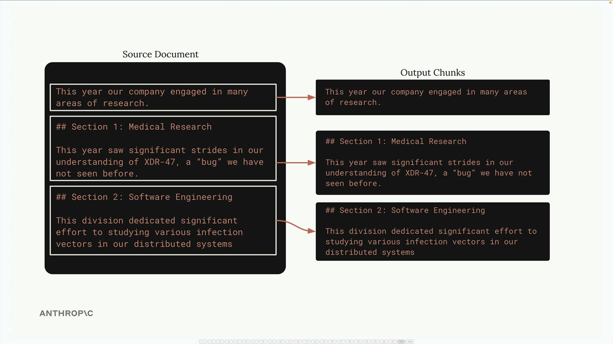

`chunk_by_char` cuts every 150 characters and `chunk_by_sentence` every 5 sentences, both with some overlap. `chunk_by_section` cuts at each `##` header.

```python
def chunk_by_char(text, chunk_size=150, chunk_overlap=20): ...

def chunk_by_section(document_text): ...

def chunk_by_sentence(text, max_sentences_per_chunk=5, overlap_sentences=1): ...
```

<br>

## Embeddings
---

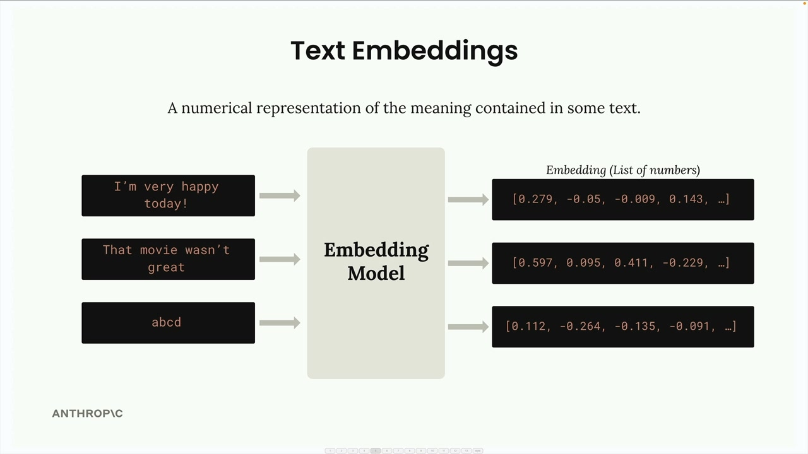

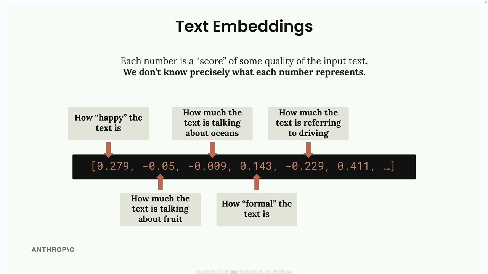

Anthropic has no embedding model of its own, so `client` here is a Voyage AI client: `voyageai.Client()`, with the key in `VOYAGE_API_KEY`. Pass `input_type="document"` for chunks and `"query"` for questions. `voyage-4-large` is the current generation of `voyage-3-large`.

```python
def generate_embedding(text, model="voyage-3-large", input_type="query"):
    result = client.embed([text], model=model, input_type=input_type)
    return result.embeddings[0]
```

<br>

## The RAG flow
---

Chunk the text, embed the chunks, store them, embed the question to find the closest chunks, then add those to the prompt.

### Embed and store the chunks
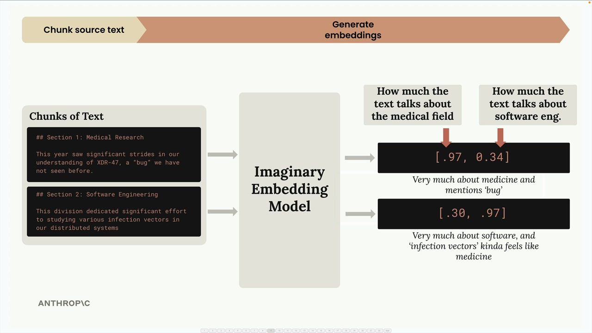

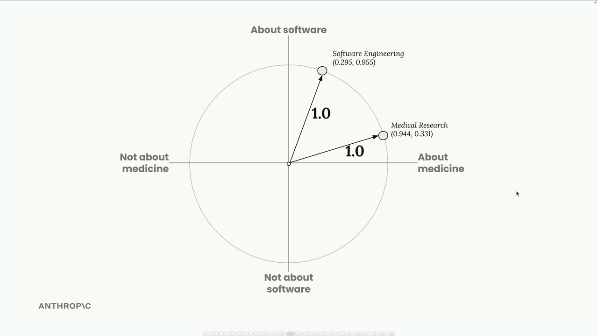

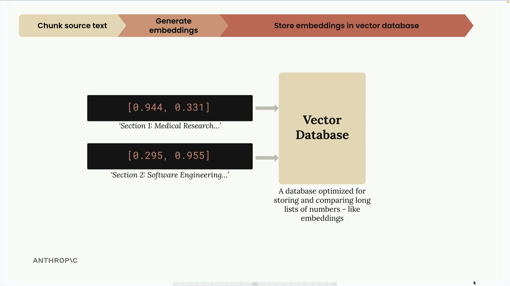

`VectorIndex` is the small in-memory store written in the course; a real app uses a vector database.

```python
embeddings = [generate_embedding(chunk, input_type="document") for chunk in chunks]

store = VectorIndex()

for embedding, chunk in zip(embeddings, chunks):
    store.add_vector(embedding, {"content": chunk})
```

### Find the closest chunks
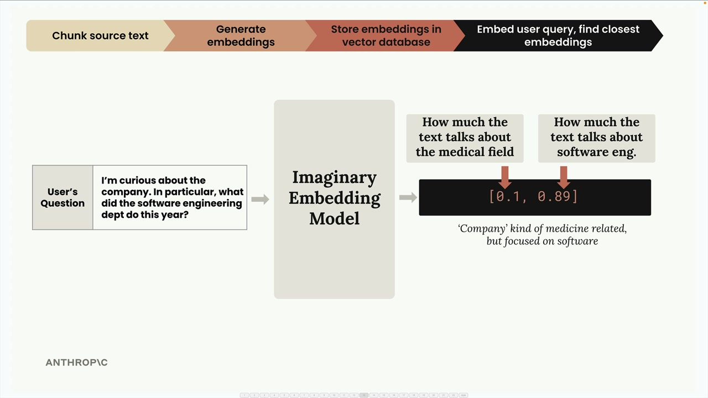

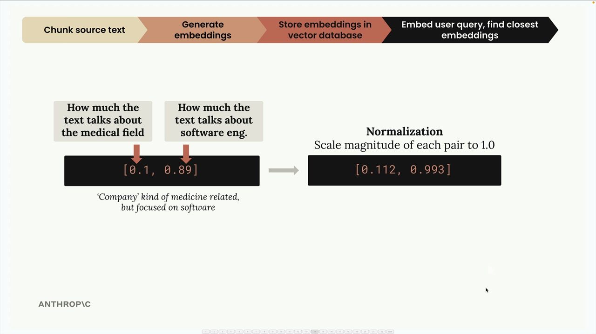

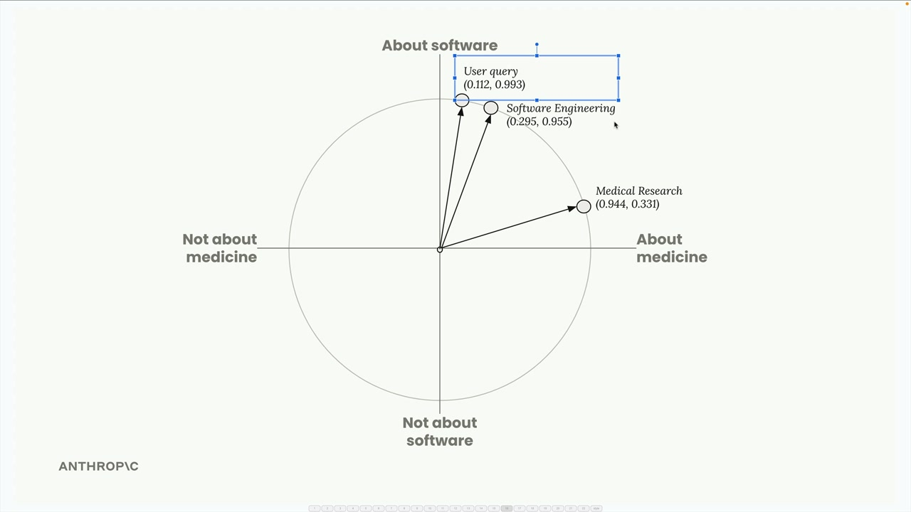

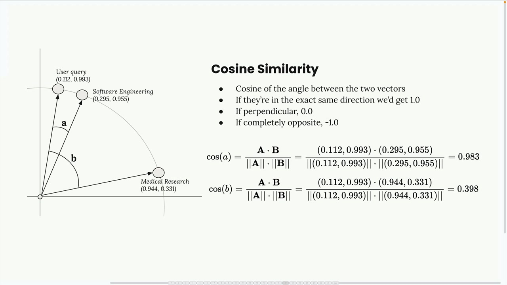

Voyage's vectors are already length 1, so cosine similarity is just their dot product ([[Inference-Next-Token-Prediction#Vectors: direction is meaning|interactive diagram]]). `search` returns the 2 nearest chunks with their distance:

```python
user_embedding = generate_embedding("What did the software engineering dept do last year?")

results = store.search(user_embedding, 2)

for document, distance in results:
    print(distance, "\n", document["content"][0:200], "\n")
```

### Add them to the prompt
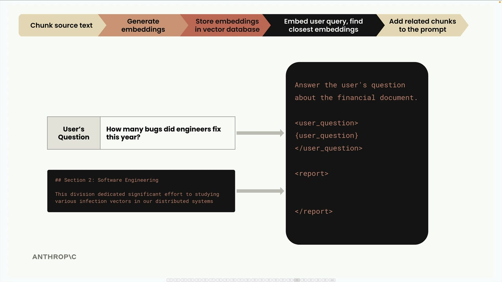

<br>

## Lexical search (BM25)
---

Embeddings can miss an exact term such as the incident ID `INC-2023-Q4-011`. BM25 finds it by giving rare terms more weight, and its results are merged with the semantic ones.

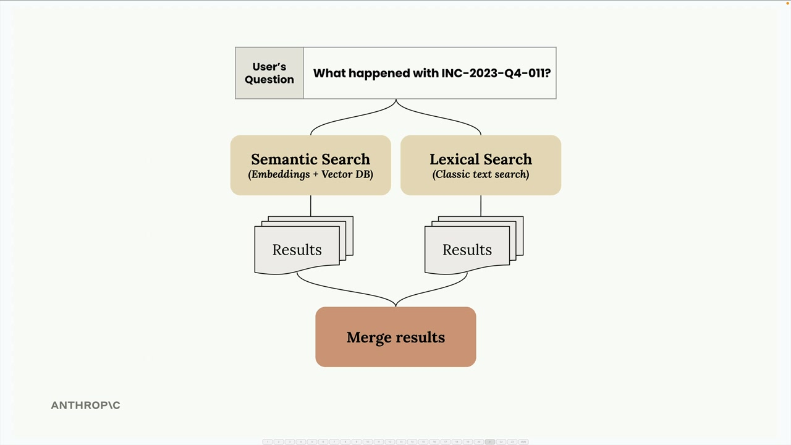

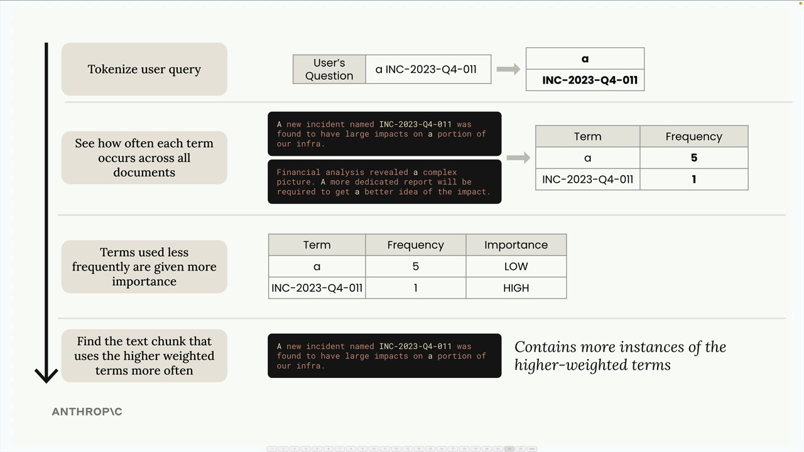
