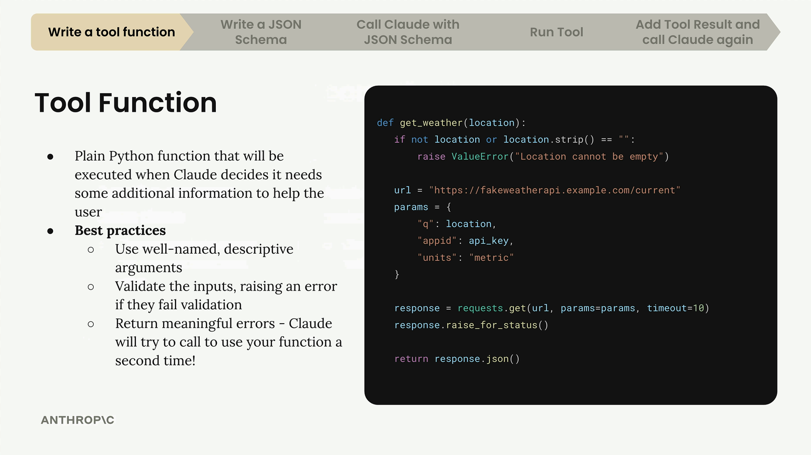
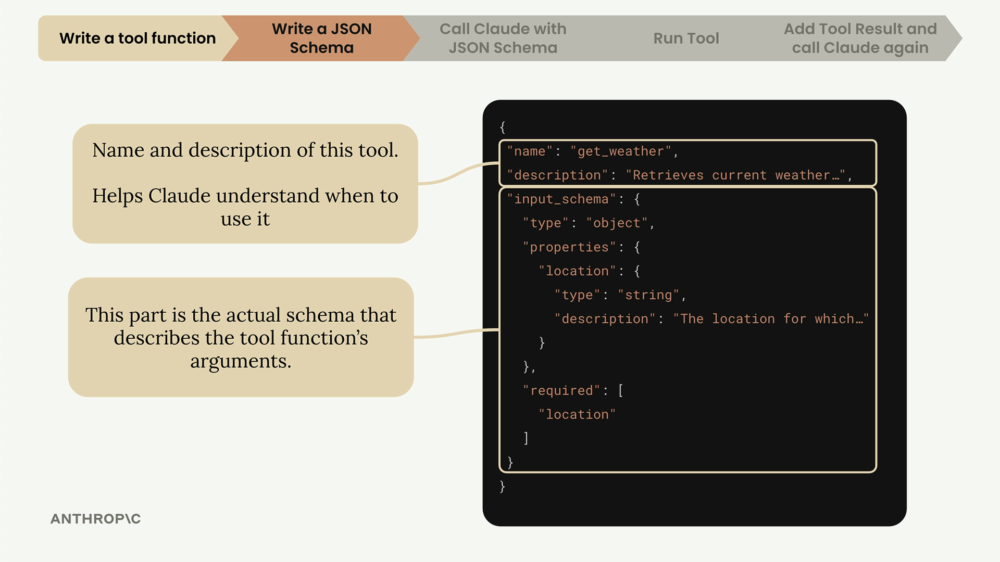
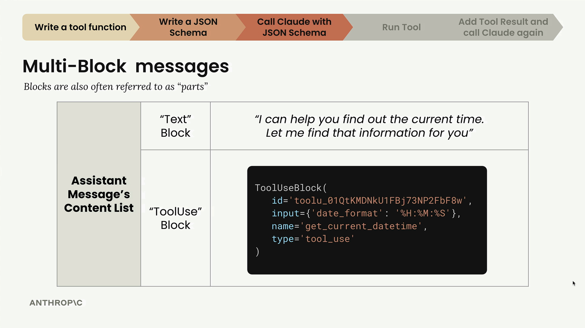
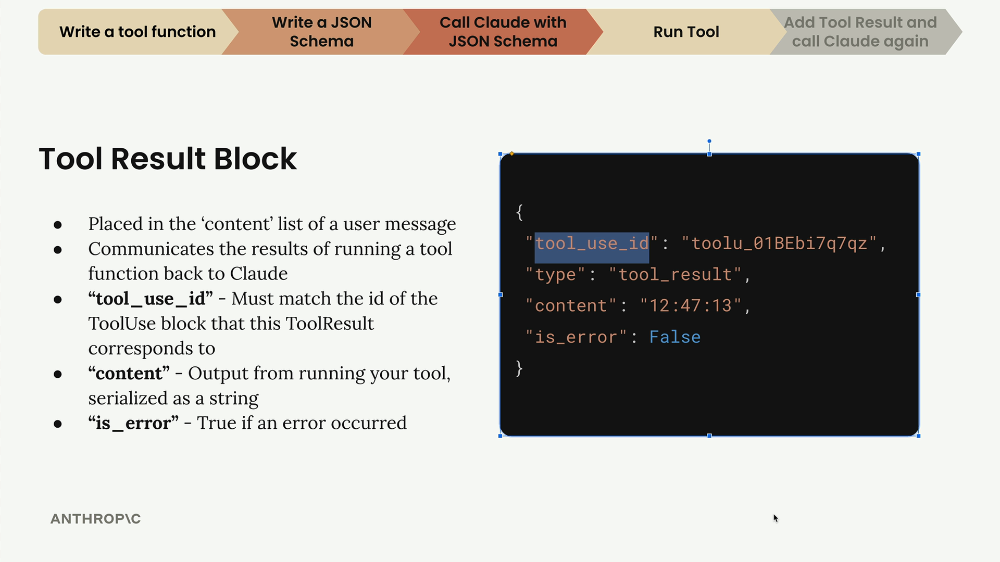
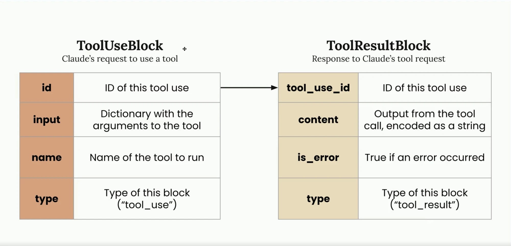
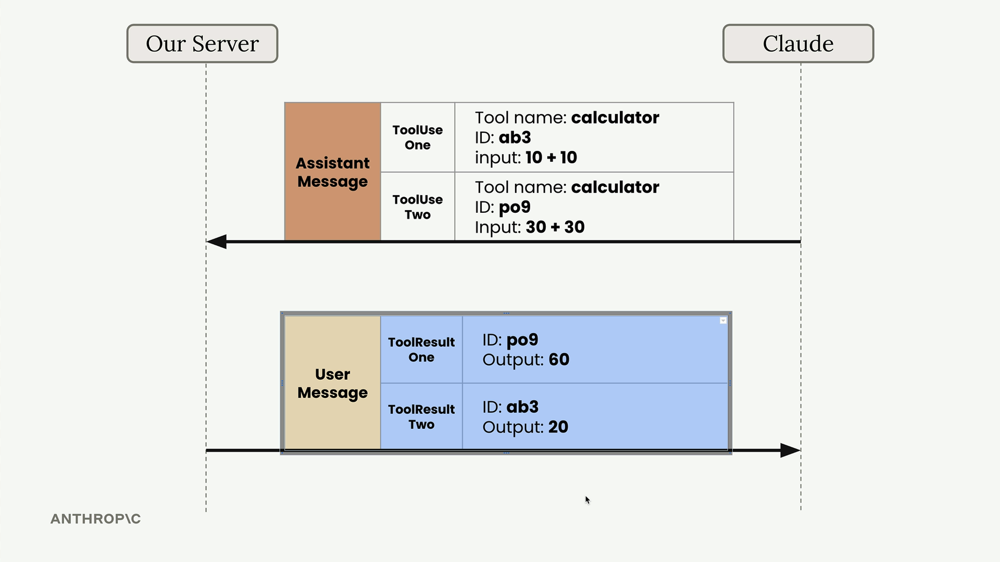
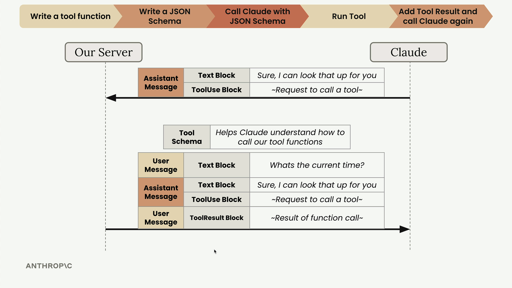
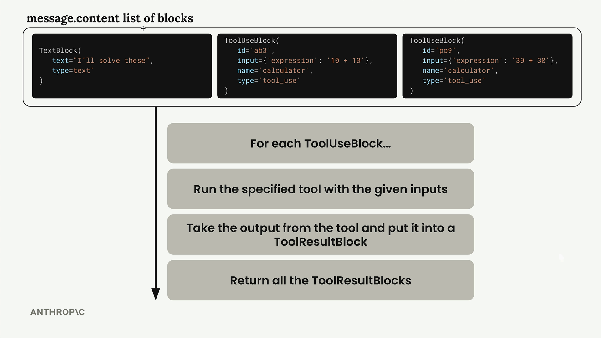
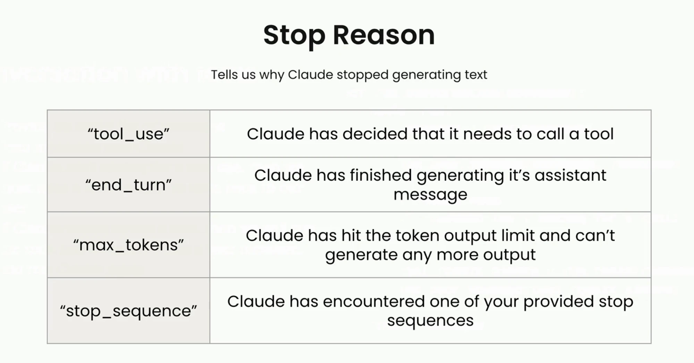

# Tool Use with Claude

← [[Claude-API-Prompt-Engineering|Prompt Engineering Techniques]] · [[Claude-API-Anthropic-Client-SDK|All chapters]] · [[Claude-API-RAG|RAG and Agentic Search]] →

Claude never runs your tools. It asks for one, your code runs it, and you send the result back ([[Agentic-Loop-Message-Cycle#One tool call, end to end|one tool call, end to end]]). The course splits this into five steps: write a tool function, write its JSON schema, call Claude with the schema, run the tool, then add the result and call Claude again.

<br>

## The five steps
---

### Tool functions
A plain Python function that your code runs when Claude asks for it. Give it descriptive argument names, validate its inputs, and raise clear errors: the error goes back to Claude, which can then try again.



### Tool schemas
The schema is how Claude learns the tool exists. `name` and `description` tell it when to use the tool, and `input_schema` describes the arguments as a JSON Schema. Clear, detailed descriptions like the ones below are what [[Domain-2-Tool-Design-and-MCP#2.1 Design effective tool interfaces with clear descriptions and boundaries|Task 2.1]] tests.



```python
add_duration_to_datetime_schema = {
    "name": "add_duration_to_datetime",
    "description": "Adds a specified duration to a datetime string and returns the resulting datetime in a detailed format. This tool converts an input datetime string to a Python datetime object, adds the specified duration in the requested unit, and returns a formatted string of the resulting datetime. It handles various time units including seconds, minutes, hours, days, weeks, months, and years, with special handling for month and year calculations to account for varying month lengths and leap years. The output is always returned in a detailed format that includes the day of the week, month name, day, year, and time with AM/PM indicator (e.g., 'Thursday, April 03, 2025 10:30:00 AM').",
    "input_schema": {
        "type": "object",
        "properties": {
            "datetime_str": {
                "type": "string",
                "description": "The input datetime string to which the duration will be added. This should be formatted according to the input_format parameter.",
            },
            "duration": {
                "type": "number",
                "description": "The amount of time to add to the datetime. Can be positive (for future dates) or negative (for past dates). Defaults to 0.",
            },
            "unit": {
                "type": "string",
                "description": "The unit of time for the duration. Must be one of: 'seconds', 'minutes', 'hours', 'days', 'weeks', 'months', or 'years'. Defaults to 'days'.",
            },
            "input_format": {
                "type": "string",
                "description": "The format string for parsing the input datetime_str, using Python's strptime format codes. For example, '%Y-%m-%d' for ISO format dates like '2025-04-03'. Defaults to '%Y-%m-%d'.",
            },
        },
        "required": ["datetime_str"],
    },
}

set_reminder_schema = {
    "name": "set_reminder",
    "description": "Creates a timed reminder that will notify the user at the specified time with the provided content. This tool schedules a notification to be delivered to the user at the exact timestamp provided. It should be used when a user wants to be reminded about something specific at a future point in time. The reminder system will store the content and timestamp, then trigger a notification through the user's preferred notification channels (mobile alerts, email, etc.) when the specified time arrives. Reminders are persisted even if the application is closed or the device is restarted. Users can rely on this function for important time-sensitive notifications such as meetings, tasks, medication schedules, or any other time-bound activities.",
    "input_schema": {
        "type": "object",
        "properties": {
            "content": {
                "type": "string",
                "description": "The message text that will be displayed in the reminder notification. This should contain the specific information the user wants to be reminded about, such as 'Take medication', 'Join video call with team', or 'Pay utility bills'.",
            },
            "timestamp": {
                "type": "string",
                "description": "The exact date and time when the reminder should be triggered, formatted as an ISO 8601 timestamp (YYYY-MM-DDTHH:MM:SS) or a Unix timestamp. The system handles all timezone processing internally, ensuring reminders are triggered at the correct time regardless of where the user is located. Users can simply specify the desired time without worrying about timezone configurations.",
            },
        },
        "required": ["content", "timestamp"],
    },
}
```

Wrapping a schema in the SDK's `ToolParam` type lets your editor catch a missing or misspelled key:

```python
from anthropic.types import ToolParam

get_current_datetime_schema = ToolParam({
    "name": "get_current_datetime",
    "description": "Returns the current date and time formatted according to the specified format",
    # ... rest of schema
})
```

### Handling message blocks
Pass the schemas in `tools`. When Claude wants a tool, the reply's `content` holds several blocks, such as a `text` block and a `tool_use` block, and `stop_reason` is `"tool_use"`. Add the whole `content` list to the history, not just its text.



```python
response = client.messages.create(
    model=model,
    max_tokens=1000,
    messages=messages,
    tools=[get_current_datetime_schema],
)
messages.append({"role": "assistant", "content": response.content})
```

### Sending tool results
Run the tool, then send its output back in a `user` message as a `tool_result` block ([[User-vs-Assistant-Messages|why a user message]]):
- `tool_use_id`: the `id` of the `tool_use` block it answers.
- `content`: the tool's output, as a string.
- `is_error`: `True` if the tool failed.



The two blocks side by side: the result's `tool_use_id` is the request's `id`, which is how Claude matches each result to its request.



If Claude asks for several tools at once, send all the results together in one user message, matched by ID in any order ([[Agentic-Loop-Message-Cycle#Rules|rules]]).



```python
tool_use_block = response.content[1]  # By order: assumes exactly one block comes first
tool_use_block = next(block for block in response.content if block.type == "tool_use")  # By type

messages.append({
    "role": "user",
    "content": [{
        "type": "tool_result",
        "tool_use_id": tool_use_block.id,
        "content": "15:04:22",
        "is_error": False
    }]
})
```

Then call Claude again with the same `tools` and the whole history. Repeat while `stop_reason` is `"tool_use"` ([[Agentic-Loop-Message-Cycle|agentic loop]]).



The history at that point, as printed:

```python
[{'role': 'user', 'content': 'What is the exact time, formatted as HH:MM:SS?'},
 {'role': 'assistant',
  'content': [TextBlock(citations=None, text="I'll retrieve the current time for you formatted as HH:MM:SS.", type='text'),
              ToolUseBlock(id='toolu_01BEbi7q7qzvwP8zSMBHp3BD', input={'date_format': '%H:%M:%S'},
                           name='get_current_datetime', type='tool_use')]},
 {'role': 'user',
  'content': [{'type': 'tool_result',
               'tool_use_id': 'toolu_01BEbi7q7qzvwP8zSMBHp3BD',
               'content': '15:04:22',
               'is_error': False}]}]
```

<br>

## Multiple tools and the loop
---

### Running multiple tools
With several tools available, one reply can ask for more than one. Run every `tool_use` block and send all the results back in one user message.



Pass all the schemas in the request. This `chat` is the one from [[Claude-API-Accessing-Claude#Multi-Turn Conversations|Multi-Turn Conversations]], changed to take `tools` and return the whole message, not just its text:

```python
response = chat(messages, tools=[
    get_current_datetime_schema,
    add_duration_to_datetime_schema,
    set_reminder_schema
])
```

> [!note] Fine-grained tool streaming
> `fine_grained=True` streams each tool's input as Claude writes it, skipping the API's JSON buffering and validation, so your code must handle partial or invalid input (current API: `eager_input_streaming: true` on each tool).

`run_tool` sends each request to the function with that name:

```python
def run_tool(tool_name, tool_input):
    if tool_name == "get_current_datetime":
        return get_current_datetime(**tool_input)
    elif tool_name == "add_duration_to_datetime":
        return add_duration_to_datetime(**tool_input)
    elif tool_name == "set_reminder":
        return set_reminder(**tool_input)
    # Add more tools as needed
```

`run_tools` answers every `tool_use` block in the reply. `content` must be a string, hence `json.dumps`. A tool that fails still gets a result, its error text with `is_error: True`: every `tool_use` needs an answer, and Claude can then react to the error.

```python
import json

def run_tools(message):
    tool_requests = [
        block for block in message.content if block.type == "tool_use"
    ]
    tool_result_blocks = []

    for tool_request in tool_requests:
        try:
            tool_output = run_tool(tool_request.name, tool_request.input)
            tool_result_block = {
                "type": "tool_result",
                "tool_use_id": tool_request.id,
                "content": json.dumps(tool_output),
                "is_error": False
            }
        except Exception as error:
            tool_result_block = {
                "type": "tool_result",
                "tool_use_id": tool_request.id,
                "content": f"Error: {error}",
                "is_error": True
            }

        tool_result_blocks.append(tool_result_block)

    return tool_result_blocks
```

Add Claude's reply, then the result blocks as the next user message, and call Claude again.

### Stop reason
`stop_reason` says why Claude stopped, so it tells your loop what to do next: on `tool_use`, run the tools and call again; on the others, stop. The API can also return `pause_turn` and `refusal` ([[Claude-Technologies-Reference#Response fields|response fields]]).



<br>

## Built-in tools
---

### Text editor tool
Claude already knows this tool's schema, so you send only its `type` and `name`. Your code still carries out each command Claude sends: `view`, `str_replace`, `create`, `insert`. The version depends on the model, and `type` and `name` change together:

```python
def get_text_edit_schema(model):
    if model.startswith("claude-3-7-sonnet"):
        return {"type": "text_editor_20250124", "name": "str_replace_editor"}
    if model.startswith("claude-3-5-sonnet"):
        return {"type": "text_editor_20241022", "name": "str_replace_editor"}
    # Claude 4 and later
    return {"type": "text_editor_20250728", "name": "str_replace_based_edit_tool"}
```

### Web search tool
A [[Claude-Technologies-Reference#Server tools|server tool]]: Anthropic runs the searches and puts the results in the same reply, so there's no function to write. `max_uses` caps the number of searches, and `allowed_domains` limits results to those sites.

```python
web_search_schema = {
    "type": "web_search_20250305",
    "name": "web_search",
    "max_uses": 5,
    "allowed_domains": ["nih.gov"]
}
```

Newer models, including `claude-opus-5-5`, also take `web_search_20260209`, which lets Claude filter the results with code before they reach its context.
