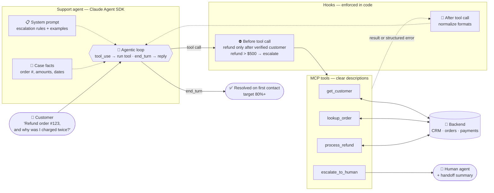

# Scenario 1: Customer Support Resolution Agent

**Easy to confuse with:** [[Scenario-3-Multi-Agent-Research|Scenario 3: Multi-Agent Research System]]. See [[Exam-Scenarios#Pairs that are easy to confuse|how to tell them apart]].

## Concepts in play
- [[Agentic-Loop-Message-Cycle|Agentic Loop: The Message Cycle]]: the loop in the middle of the diagram
- [[Deterministic-Compliance|Deterministic Compliance]]: refund only after verification, enforced by a hook
- [[Sycophancy]]: "I already verified earlier!"
- [[Tool-Choice|Tool Choice]]: `auto` lets the agent reply in text or call a tool
- [[User-vs-Assistant-Messages|User vs Assistant Messages in Tool Calls]]: a `lookup_order` result goes back as a user message
- [[Agent-SDK-vs-Client-SDK|Agent SDK vs Client SDK]]: built with the Agent SDK
- [[Claude-Technologies-Reference#Hooks|Hooks (reference)]]
- [[Claude-Technologies-Reference#MCP (Model Context Protocol)|MCP tools and structured errors (reference)]]
