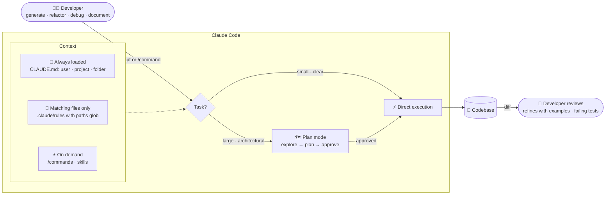

# Scenario 2: Code Generation with Claude Code

**Easy to confuse with:** [[Scenario-4-Developer-Productivity|Scenario 4: Developer Productivity with Claude]], [[Scenario-5-Claude-Code-in-CI|Scenario 5: Claude Code for Continuous Integration]]. See [[Exam-Scenarios#Pairs that are easy to confuse|how to tell them apart]].

## Concepts in play
- [[Glob]]: `paths:` globs in `.claude/rules`
- [[Claude-Technologies-Reference#Claude Code configuration|CLAUDE.md, rules, commands, skills and plan mode (reference)]]
