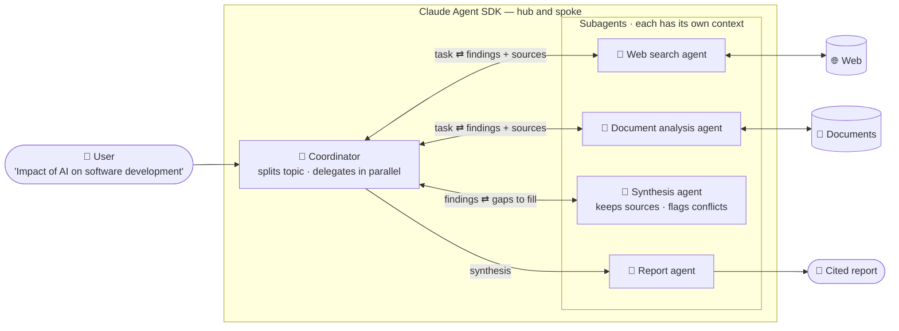

# Scenario 3: Multi-Agent Research System

**Easy to confuse with:** [[Scenario-1-Customer-Support|Scenario 1: Customer Support Resolution Agent]]. See [[Exam-Scenarios#Pairs that are easy to confuse|how to tell them apart]].

## Concepts in play
- [[Passing-Context-to-Subagents|Synthesis Subagent & Passing Context to Subagents]]: the synthesis subagent only knows what is in its prompt
- [[Preserving-Attribution|Passing Information Between Agents & Preserving Attribution]]: every claim keeps its source between agents
- [[Task-Decomposition|Decomposition]]: splitting "AI in software development" too narrowly
- [[Agent-SDK-vs-Client-SDK|Agent SDK vs Client SDK]]: built with the Agent SDK
- [[Claude-Technologies-Reference#All together Scenario 3 as configuration|This scenario as Agent SDK configuration (reference)]]
