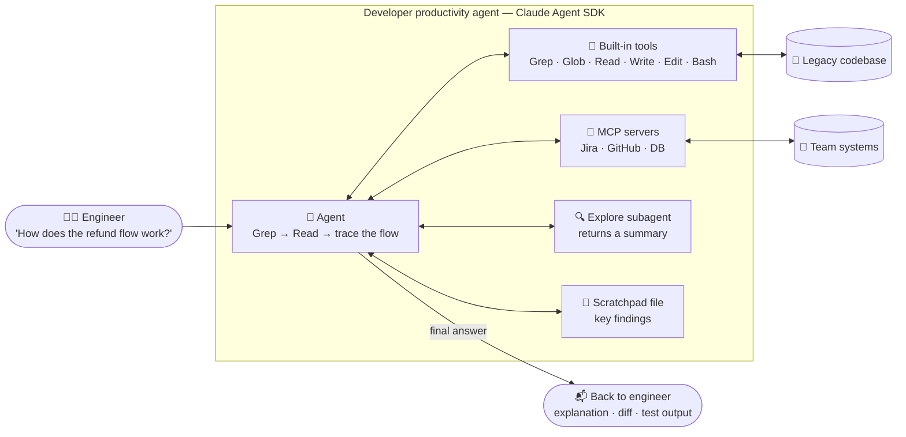

# Scenario 4: Developer Productivity with Claude

**Easy to confuse with:** [[Scenario-2-Code-Generation|Scenario 2: Code Generation with Claude Code]]. See [[Exam-Scenarios#Pairs that are easy to confuse|how to tell them apart]].

## Concepts in play
- [[Grep]]: find the entry point before reading files
- [[Glob]]: find files by name or extension
- [[Task-Decomposition|Decomposition]]: dynamic decomposition for a legacy codebase
- [[Agent-SDK-vs-Client-SDK|Agent SDK vs Client SDK]]: built with the Agent SDK
- [[Claude-Technologies-Reference#Claude Code configuration|Explore subagent (reference)]]
