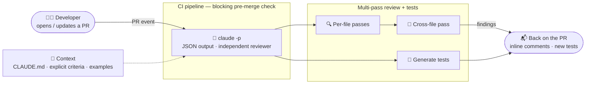

# Scenario 5: Claude Code for Continuous Integration

**Easy to confuse with:** [[Scenario-2-Code-Generation|Scenario 2: Code Generation with Claude Code]], [[Scenario-6-Structured-Extraction|Scenario 6: Structured Data Extraction]]. See [[Exam-Scenarios#Pairs that are easy to confuse|how to tell them apart]].

## Concepts in play
- [[Claude-Code-Headless-Mode|Claude Code Headless Mode]]: `claude -p` runs in the pipeline
- [[Task-Decomposition|Decomposition]]: per-file passes, then one cross-file pass
- [[Message-Batches-API|Message Batches API]]: batch the nightly work, not the blocking pre-merge check
- [[Claude-Technologies-Reference#Claude Code CLI|Claude Code CLI flags (reference)]]
