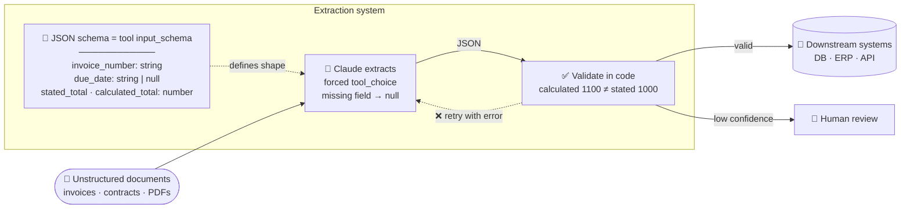

# Scenario 6: Structured Data Extraction

**Easy to confuse with:** [[Scenario-5-Claude-Code-in-CI|Scenario 5: Claude Code for Continuous Integration]]. See [[Exam-Scenarios#Pairs that are easy to confuse|how to tell them apart]].

## Concepts in play
- [[JSON-Schema-for-Structured-Extraction|JSON Schema for Structured Extraction]]: the schema fixes the shape, your code checks the values
- [[Tool-Choice|Tool Choice]]: `any` for unknown document types, forced for a fixed first step
- [[Message-Batches-API|Message Batches API]]: a forced `tool_choice` works inside a batch
- [[Agent-SDK-vs-Client-SDK|Agent SDK vs Client SDK]]: works at the API level
